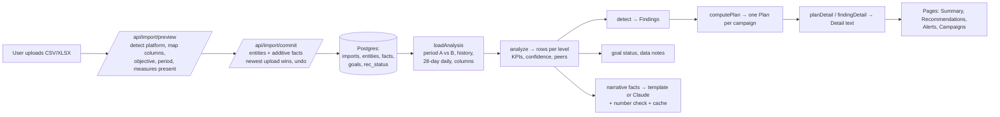
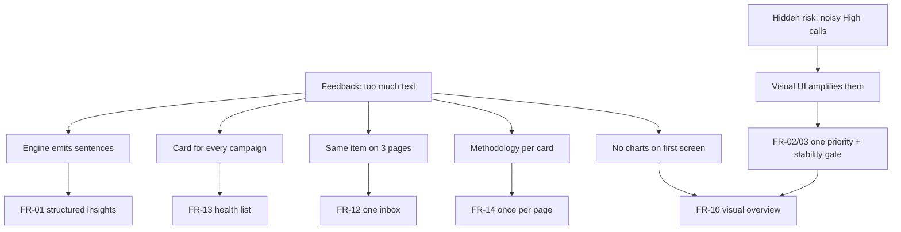

# AdMate — Market Requirements Document (MRD)
## Insight & Dashboard Experience, next version

| | |
|---|---|
| **Status** | **Approved for Phase 1 on 2026-10-15** (founder interview; decisions in §0). Built on branch `v3-insights`; v2 is preserved as git tag `v2`. |
| **Date** | 2026-10-14 (decisions added 2026-10-15) |
| **Codebase audited** | Local repo, branch `product-v2-campaign-plan` @ `891fb0a` (clean working tree) |
| **Reference** | *Madgicx Sample Dashboard.pdf* (5 pages: 4 pages of screenshots + 1.5 pages of capability text) |
| **Prepared by** | Claude (AI), acting as PM / UX / analytics / architecture reviewer |
| **Companion docs** | [prd.md](../prd.md) (v1.1 spec + decision log), [docs/product-plan.md](product-plan.md) (v2 plan, founder-approved 2026-09-29) |

### How to read the labels

Every finding carries one label:

| Label | Meaning |
|---|---|
| **[Verified]** | Directly supported by the current code, by a measurement I ran on the built-in sample data, or by the reference PDF. File references are given. |
| **[User feedback]** | Stated by users or stakeholders. In this review, the only user feedback available is what the founder relayed in the brief (see §3). |
| **[Inference]** | My reasoned interpretation of the evidence (including standard ad-platform domain knowledge). Could be wrong; says why it's believed. |
| **[Proposal]** | A recommended future direction. Not built. |
| **[Open question]** | Needs information or validation that this review could not obtain. |

---

## 0. Founder decisions (interview, 2026-10-15)

These answer the open questions in §24 and **override the original proposals wherever they differ**. The sections below have been updated to match.

| Topic | Decision | Effect on this MRD |
|---|---|---|
| Target segment (Q1) | **One-account owners** (business owners, in-house marketers). Multi-account stays P2 | FR-22 stays P2 |
| Scale/cut sensitivity (Q3) | **Fewer, later, reliable**: significance **and** persistence before any High scale/cut. Tracking breaks and zero-result spend still alert immediately | FR-03, §16.3 |
| Judging order (Q4) | **Keep past-first** (own past → target → other campaigns), as decided on 2026-09-30. A campaign improving vs its past but still off target **keeps its "scale" call, with a visible target-gap warning** | Replaces "target gates scaling" in FR-03 / §16.3 / AR-6 |
| Alerts + Recommendations (Q2) | **Merge into one Actions list** with filters (Problems · Opportunities · Monitoring · Done) and one badge | FR-12 |
| Stable campaigns | **Health-list rows only**, with no card and no Actions entry | FR-13 |
| Overview first glance | **Status pills**, then a **one-line** optional summary | S2, FR-10 |
| Overview visuals | Founder delegated the choice. **Goal bullet bars, KPI tiles + sparklines, campaign health list** by default; trend chart opens from a KPI tile | §13.2, S7 |
| Row action button | **Opens the detail drawer** (no deep link yet) | S5, FR-11 |
| Expected impact (Q5) | **Backward-looking only** | §15.4 |
| Jargon | **Plain label + term** on first use ("Cost per 1,000 views (CPM)"), hover/tap definition | FR-14 |
| Device | **Desktop-first; must work at phone width** | FR-10 |
| Funnel role | **Guessed from campaign name + one-click override** (small DB migration) | FR-07 |
| Real exports (Q8) | May be used **locally only** for calibration; never committed, never sent to external services | §22.3 |
| Engine refactor | **Incremental**. v2 kept as git tag `v2`; v3 built on branch `v3-insights`; live site stays v2 until approved | §25 |
| Prototype testing | **Founder reviews the prototype alone** first; user tests later | §22.2 |
| Raw user feedback (Q6) | Not available; **proceed** and validate with the prototype | §3 |
| Ask AdMate | **Hidden until ready** (no "Ask AdMate why" buttons, no nav item while off) | FR-08 |
| Day-vs-day comparisons | **Kept, labelled exploratory**; no scale/cut calls on single days | AR-17 |
| Share report | **Stays P2** | FR-20 |
| Phase 1 scope | **Static prototype + v2 snapshot + P0 logic fixes**, proven by the backtest. UI redesign after the founder has seen the prototype | §25 |
| Objectives (added 2026-10-15) | **App registrations** (cost per registration, new `registrations` result column) and **Website visits** (cost per landing page view) join the existing nine, making 11. Not covered yet: Google local store visits, Google call ads (calls) and LinkedIn job applicants | §9.2, FR-07 |

---

## Table of contents

1. Executive Summary
2. Product Background and Current MVP Status
3. Problem Statement and User Feedback
4. Target Users and Primary Use Cases
5. Research Methodology and Scope
6. Existing Architecture and Feature Audit
7. Current Dashboard UX/UI Audit
8. Current Analytical Logic Audit
9. Madgicx Reference Analysis
10. AdMate vs. Madgicx Capability Comparison
11. Key Problems and Root Causes
12. Product Vision and Design Principles
13. Proposed Dashboard Information Architecture
14. Proposed Dashboard UX/UI Improvements
15. Proposed AI Insights and Recommendation Logic
16. Proposed Campaign Health and Prioritization Framework
17. Functional Requirements and User Stories
18. Analytical Rules and Data Requirements
19. Edge Cases, Limitations, and Risks
20. MVP Scope and Feature Prioritization
21. Future Roadmap
22. Success Metrics and Validation Plan
23. Technical Dependencies and Feasibility
24. Open Questions and Assumptions
25. Implementation Plan for a Future Approved Phase
- Appendix A: Measurement method and raw results
- Appendix B: Source file index

---

## 1. Executive Summary

### What AdMate is today

- **[Verified]** AdMate is a working Next.js app (deployed on Vercel + Neon Postgres) where a user uploads CSV/XLSX exports from Meta, TikTok, Google Ads or LinkedIn. A deterministic engine judges every campaign by the KPI that fits its objective, runs 18 detector rules for issues and opportunities, gives each campaign one next step, and explains everything in sentences built from computed numbers. AI (Claude) only rewords verified numbers, and a number check rejects AI text that contains numbers the engine didn't produce.
- **[Verified]** The analytical foundations are better than most dashboards: missing columns are never read as zero, reach is never summed across rows, confidence is derived from volume plus a significance test, every finding states the rule that fired, and nothing is ever written back to an ad account.
- **[Verified]** The UI is almost entirely text. On the built-in sample account (6 campaigns), the Recommendations page renders **~484 words with every card collapsed and ~3,400 words fully expanded**; Alerts renders ~390 words collapsed. The Account summary has **no chart**; the only time-series chart in the product is two clicks deep inside the Campaigns page (§7.2).

### The core diagnosis

The "too much text" feedback is **structural, not cosmetic**. Shrinking fonts or trimming copy won't fix it, because:

1. **The engine outputs prose, not data.** Findings and plans carry their meaning in pre-written sentences (`whatHappened`, `why`, `action`, `likelyCause`…). The UI can only display sentences because sentences are all it receives. **[Verified]**
2. **Every campaign gets a full card**, including campaigns that are fine ("Keep running"). **[Verified]**
3. **The same item appears in 2–3 places** (Account summary → Alerts → nested inside Recommendations). All 5 alerts on the sample account are repeated inside Recommendations cards. **[Verified]**
4. **Methodology and disclaimers are repeated on every card** instead of once per page (e.g., a 13-word "AdMate never changes your campaigns" footer on every card; a ~65-word "how AdMate judges" note on every card when an account has only one upload, which is every new user's first session). **[Verified]**
5. **Numbers live inside sentences** ("Cost/follow 61% more expensive than its Sep 30 – Oct 6 results") rather than in visual encodings (delta chip, bar vs target, sparkline). **[Verified]**

### A second, more urgent finding: the analysis must be made steadier before it is made more visual

A visual red alert is more persuasive than a hedged paragraph. Making the UI more visual will **amplify** whatever the engine says, so the engine's calls need to be reliable first.

- **[Verified — backtest on sample data]** I replayed the sample account week by week. Before its planted problems begin, the sample's campaigns run on **constant underlying rates** (only random noise). Yet in **6 of 7 such weeks** AdMate issued at least one **High-priority "Put more money in" or "Cut or fix"** call. One campaign ("Leads | Skin quiz form") was told *scale* → *cut* → *cut* → *scale* across weeks with no real change (§8.4).
- **[Verified]** The same campaign can receive **contradictory advice on different pages**: Recommendations says "Cut its budget by 20–30%" (High) while the finding nested under it, also shown on Alerts, says "Hold the budget… this is auction cost, not your creative" (Medium) (§8.6, AL-3).
- **[Verified]** A "budget concentration" alert fired in **7 of 8 weekly views** (High in 5) on the sample's broad prospecting campaign because it is compared with a retargeting campaign. Retargeting is structurally cheaper, so this is a predictable false alarm (§8.6, AL-6).
- **[Verified]** When a comparison period exists, a campaign is judged against its own previous period *before* the user's target. So a campaign that improved from very bad to bad can be told to "put more money in" while the home page says the objective is "far off target" (AL-4).

### What I recommend

| Priority | Theme | Summary |
|---|---|---|
| **P0** | Trustworthy signals | One insight model and one priority system across all pages; stability gate (significance + persistence) before any scale/cut call; target-gap warning on scale calls (past-first judging kept, §0); attribution-lag guard on the most recent days; funnel-role-aware comparisons; consistent threshold definition; revenue-tracking check. |
| **P0** | Structured insights | The engine emits structured fields (metric, baseline, delta, valence, severity, confidence, money at stake, action verb), so the UI can render visuals instead of sentences. |
| **P1** | Visual Overview | Status line + goal progress bars + 4 KPI tiles with sparklines + "Needs your decision" queue (top 3–5) + campaign health list + trend chart. |
| **P1** | Progressive disclosure | One-line insight rows → detail drawer (evidence chart, hypothesis, action, impact, confidence) → "How AdMate judged this" (once per page). |
| **P1** | De-duplicate | Merge Alerts and Recommendations into one Actions inbox with filters; stable campaigns go in a compact list, not cards. |
| **P2** | Share & scale | Shareable report link/PDF; sensitivity setting; multi-account overview *if* agencies/freelancers are confirmed as a target; Meta read-only API discovery. |
| **P3** | Explore later | Creative content analysis; MCP access to AdMate data; controlled write actions. |
| **Not recommended** | Cloud/server-side tracking | Different business (infrastructure), high liability, poor fit with an analytics MVP (§9.2-D). |

### The most useful Madgicx lessons (from the PDF, not as requirements)

1. **One-line recommendations with an action button; detail on demand** in three short bullets (PDF p.2, p.4). AdMate's equivalent of the button is "Mark as done" and a re-check, since AdMate is advisory.
2. **Goals as progress bars** ("Revenue $70,000 / $100,000") rather than sentences (PDF p.2).
3. **Uniform KPI tiles: big number + delta chip**, with charts on the first screen (PDF p.1).
4. **Grouping by funnel strategy** (Prospecting / Re-engagement / Retargeting / Retention) in the 360° audit (PDF p.2). This is directly relevant to AdMate's false alarm AL-6.
5. **What *not* to copy:** unexplained savings claims ("$221,900 saved", PDF p.3), one-click execution without evidence or confidence, and blended cross-platform metrics that hide attribution differences.

### Decision needed before design starts

**[Open question]** The brief lists four target segments (freelancers, in-house marketers, agencies, business owners). On 2026-09-29 the founder narrowed the design center to **one person managing their own ad account**, and the cross-client view was removed (`docs/product-plan.md` §1, decision 2). The proposed Overview works for single-account users. A multi-account portfolio view is P2 and depends on this decision (§4, §24 Q1).

---

## 2. Product Background and Current MVP Status

### 2.1 Positioning **[Verified]**

From [README.md](../README.md): *"AI marketing analyst for people who run their own ads. Upload an export from Meta, TikTok, Google Ads or LinkedIn and AdMate tells you what needs attention, why, and what to do next, with the numbers behind every suggestion."*

### 2.2 History of decisions **[Verified]**

| Date | Decision | Source |
|---|---|---|
| 2026-09-29 | PRD v1.1: freelancer-first, multi-client "Today" view, Health Score, $-impact ranking, PDF reports | `prd.md` §0.1 |
| 2026-09-29 | Product plan v2: **one-account owner** as design center; Health Score and $/week estimates **removed**; goal status + money at stake; fixed conservative thresholds; no external benchmarks | `docs/product-plan.md` §1, §6, §9 |
| 2026-09-29/30 | Navigation: Account summary · Recommendations · Alerts · Campaigns · Reports · Upload · Targets & settings | `docs/product-plan.md` §16–18 |
| 2026-09-30 | Judging order: **own past results → target → other campaigns → (future) Cambodia benchmarks** | `docs/product-plan.md` §19 |
| After | Vercel + Neon deploy, email/password auth with invite code, PostHog analytics | `README.md`, recent commits |

### 2.3 Current status at a glance

| Area | Status | Label |
|---|---|---|
| CSV/XLSX import (Meta, TikTok) | Functional, tested on real exports | [Verified] (`README.md`, `tests/ingest.test.ts`) |
| CSV/XLSX import (Google Ads, LinkedIn) | Functional by documented column names; **not tested on real files** | [Verified] (`app/c/[ws]/upload/page.tsx:53`) |
| Analysis engine (KPIs, comparisons, confidence, detectors, plan) | Functional | [Verified] |
| Goal status, targets, break-even | Functional | [Verified] |
| Template summaries + copyable "Summary report" | Functional | [Verified] |
| AI-written summaries | Functional **only when `ANTHROPIC_API_KEY` is set**; whether production has a key is unknown | [Verified] / [Open question] |
| Ask AdMate assistant | Built, unit-tested offline, **switched off** (`ADMATE_ASK_ENABLED`), shows "Soon" | [Verified] (`lib/ai/client.ts:12`) |
| Action status (In review / Action taken / Dismiss) + "Did it work?" re-check | Functional | [Verified] |
| Snooze | Supported in the backend, **no UI button** | [Verified] (`app/actions.ts:90`, `components/AnalysisCard.tsx:146-172`) |
| Sample account | **Simulated** data (90 days, deterministic noise, planted issues) | [Verified] (`lib/sample/generate.ts`) |
| PDF / share links, creatives view, API connectors, email alerts, multi-client view, write actions | Not built | [Verified] |
| Real users | MVP shared with some users for feedback; usage volume unknown | [User feedback] / [Open question] |

---

## 3. Problem Statement and User Feedback

### 3.1 Feedback received

- **[User feedback]** *"The current AdMate dashboard contains too much text. Users need a faster, more visual, and more intuitive way to understand advertising performance."* (relayed by the founder in the brief for this review).
- **[Verified]** No raw feedback artifacts exist in the repository: no interview notes, survey results, support tickets or session analyses. PostHog is instrumented (page views, session replays with masked text, and named events: `report_upload_started`, `report_previewed`, `report_uploaded`, `report_upload_failed`, `report_undone`, `ask_sent`, `summary_generated`; see `README.md`). **No events exist for viewing, expanding, acting on or dismissing an insight**, so we can't yet tell from data *which* screens users struggle with.
- **[Open question]** How many users gave the feedback, which screens they meant, whether they used the sample or their own data, and whether PostHog session replays show where they stopped reading.

### 3.2 Problem statement

> People who run ads need to know, in under a minute, **whether their ads are OK, what needs a decision first, and what to do**, and to trust that answer. AdMate's engine already computes most of the evidence, but delivers it as long, repeated prose spread across several pages. The brain is doing the work but the user still has to read it all. In some situations the engine also calls normal week-to-week noise a reason to scale or cut, and a more visual UI would make those calls even more convincing.

### 3.3 The seven user questions, and how AdMate answers them today

| # | User question | Where AdMate answers today | How well **[Inference, from §7–8]** |
|---|---|---|---|
| 1 | How are my campaigns performing? | Account summary: 3-line summary, KPI strip, goal status lines | Partly. All text; no trend; goal status is a sentence per objective |
| 2 | What is going well or badly? | Goal status chips; Alerts; "Doing best / Weakest" boxes on Campaigns | Spread over 3 pages; good and bad share the same red "High" styling |
| 3 | Which campaigns need attention first? | Next steps (top 3 High); Alerts order; "Look at this first" | Answered, but the High list mixes urgent problems with scaling opportunities |
| 4 | Why might a campaign be underperforming? | "Why this might be happening" (expanded card) | Good content, labelled as hypotheses; buried behind "Show analysis" |
| 5 | What should I do next? | Plan action per campaign; finding actions | Answered, but can conflict between pages (AL-3) |
| 6 | What impact could the action have? | "Extra cost vs before", money at stake | Backward-looking only (by founder decision); no visual |
| 7 | Understand without reading a long explanation? | n/a | **Not met** (the feedback) |

---

## 4. Target Users and Primary Use Cases

### 4.1 Segments

| Segment | Core need | Accounts | Current fit **[Verified/Inference]** |
|---|---|---|---|
| **Business owner running own ads** (v2 design center) | "Am I wasting money? What do I do?" Plain language, minimal jargon | 1 | Best fit: plain language and goal status. But too much reading for a non-specialist |
| **In-house marketer** | Same, plus a leadership-ready summary | 1–3 | Good: the Summary report exists. Lacks a visual one-pager to share |
| **Freelancer** | Morning triage across clients; client reports | 3–10 | Weak: no portfolio view (removed in v2); one account at a time; no share link/PDF |
| **Agency** | Portfolio triage, consistent reporting, team | 10–60 | Not served: no portfolio, no roles, no white-label, upload-only doesn't scale to 60 accounts |

**[Inference]** Upload-only ingestion is the main barrier for freelancers and agencies: uploading 4 platform exports for each of 10 clients every week is unlikely to be sustained. Any serious move toward these segments depends on read-only API connectors (§21).

**[Open question]** Which segment(s) the next version is designed for (see §24 Q1). This MRD's P0/P1 scope **works for all four segments** (one account at a time). Portfolio features are P2 and gated on this answer.

### 4.2 Primary use cases

| ID | Use case | Frequency | Segment | Questions served |
|---|---|---|---|---|
| UC-1 | **Check-in:** "Is everything OK?" in under 60 seconds | Daily/weekly | All | Q1, Q2 |
| UC-2 | **Triage:** find the 1–3 things that need a decision | Weekly | All | Q3 |
| UC-3 | **Diagnose:** understand why a KPI moved | When something moves | Marketers, freelancers | Q4 |
| UC-4 | **Decide & act:** pick an action, make it in the ad platform, mark it done | Weekly | All | Q5, Q6 |
| UC-5 | **Verify:** did the change work? | 3–7 days later | All | Q5 |
| UC-6 | **Report:** share an update with a boss or client | Weekly/monthly | In-house, freelancer, agency | Q1, Q7 |
| UC-7 | **Portfolio triage:** which account needs me first | Daily | Freelancer, agency | Q3 (P2) |

---

## 5. Research Methodology and Scope

### 5.1 What I did (read-only)

1. **Read the codebase:** all pages in `app/c/[ws]/`, layout/shell/navigation, every component on the analysis pages, the whole analysis engine (`lib/analysis/*`), metrics (`lib/metrics/*`), data loading (`lib/data/workspaces.ts`), schema (`lib/db/schema.ts`), AI layer (`lib/ai/*`), ingestion (partial: `lib/ingest/normalize.ts`), sample generator, tests, `README.md`, `prd.md`, `docs/product-plan.md`.
2. **Read the reference PDF:** all 5 pages (screenshots and text).
3. **Measured current behavior on the built-in sample data.** I wrote a scratch script (in my temporary scratchpad, **outside the repo**) that imports the engine read-only and runs it on the deterministic sample accounts, the same way `tests/helpers.ts` does. It measured: (a) the word count of the text each page renders, by summing the engine strings each card displays, and (b) how each campaign's verdict changes across consecutive weekly and daily views. Caches went to the scratchpad. `git status` was clean before and after. Method and raw results are in Appendix A.

### 5.2 What I did not do, and why

| Not done | Why | Effect on conclusions |
|---|---|---|
| Use the running app in a browser | It requires creating an account (writes to the DB), and `next dev` rewrites `AGENTS.md`. Both are excluded by the brief. The live site needs an invite code and sign-up | UX findings come from component code and engine output, not screenshots. Layout and visual weight are inferred from the Tailwind classes |
| Analyse real user exports | None are in the repo (`fixtures/private/` is git-ignored and I did not open private data) | Backtest results are on **simulated** data. Real-data noise is usually higher (Inference) |
| Read PostHog / session replays | No access | Can't say which screens users abandon |
| External web research | Not needed for this scope. Competitor statements beyond the PDF come from `prd.md` §3, which the founder wrote earlier, and are **not re-verified** | Madgicx analysis is limited to what the PDF shows |
| User interviews | Out of scope | All usability targets in §22 are hypotheses to test |

---

## 6. Existing Architecture and Feature Audit

### 6.1 Technology stack **[Verified]** (`package.json`, `README.md`)

| Layer | Technology |
|---|---|
| Framework | Next.js **16.3.6** (App Router, server components, server actions), React 19.2 |
| Styling | Tailwind CSS 4; brand tokens in `app/globals.css` (Violet `#7F61FF`, Signal `#C2E233` used "at most once per screen", Space Grotesk + IBM Plex Mono); light and dark mode |
| Data | Drizzle ORM; PGlite (embedded Postgres) locally; Neon Postgres on Vercel (Singapore region) |
| Auth | Email + password (scrypt), DB sessions, 30-day cookie, invite code on sign-up |
| AI | `@anthropic-ai/sdk`; model `claude-opus-5-5` by default (`ADMATE_MODEL`); low effort for summaries, medium for chat; prompt caching; `ai_usage` logging; daily question cap |
| Analytics | PostHog via `/ingest` proxy |
| Charts | **No chart library**; one hand-written SVG line chart (`components/TrendChart.tsx`) |
| Tests | Vitest: 37 tests on ingest, analysis and assistant |

### 6.2 Data flow **[Verified]**



Analysis is **recomputed on every page load** from facts. Only user decisions (status, dismiss reason, done baseline) and AI text are stored (`docs/product-plan.md` §15 deviation note; `lib/db/schema.ts`).

### 6.3 Data available per row **[Verified]** (`lib/db/schema.ts` `facts`)

Spend, impressions, reach, clicks (all), link clicks, landing page views, engagements, follows, video views, ThruPlays, leads, messages, installs, purchases, conversions (generic), conversion value, lead form opens. Entity attributes: platform, level (campaign / ad set / ad), objective (+ source), status, secondary status, budget (single value), first/last seen. Import attributes: currency, attribution setting (text), granularity (daily / snapshot), columns present.

**Not available [Verified]:** creative assets (images, video, thumbnails, copy), placements, audience and demographic breakdowns, budget-change history, bid strategy, learning-phase start date, video quartiles, per-row attribution, and backend/CRM revenue. These gaps limit creative analysis and causal diagnosis (§9, §19).

### 6.4 Pages and navigation **[Verified]** (`components/AccountNav.tsx`)

| Nav item | Route | Main content |
|---|---|---|
| Account summary | `/c/[ws]` | Period bar · summary (3 lines) · KPI strip (spend + up to 3 objectives) · goal status list · data notes · "Next steps" (counts + top 3 High) |
| Recommendations (badge) | `/recommendations` | Account-wide findings · High / Medium / Low (collapsed) sections · **one `AnalysisCard` per campaign that spent** · "Also found in this campaign" nested cards · Did it work? |
| Alerts (badge) | `/alerts` | Data warnings · detected problems + campaigns worse than expected · Early signals (collapsed) |
| Campaigns | `/campaigns` | Level tabs · objective chips · per objective: Doing best / Weakest boxes, expander "vs period: what moved it + daily trend", **9-column table, min-width 1180px** |
| Reports | `/reports` | Upload list: open / compare with previous / undo |
| Upload report | `/upload` | Upload flow + export guides |
| Targets & settings | `/settings` | Targets, break-even inputs, account |
| Ask AdMate | Side panel | Off ("Soon") |

Legacy routes `/compare`, `/actions` and `/data` redirect. **[Verified]**

### 6.5 Feature audit: functional vs partial vs simulated

| Feature | Implementation | Status | Notes |
|---|---|---|---|
| Objective-aware KPIs (9 objectives) | `lib/metrics/objectives.ts` | Functional | Sales → ROAS when revenue exists, else CPA; Awareness → cost/1K reached, or CPM when reach can't be used |
| Missing ≠ zero | `imports.columns`, `lib/metrics/availability.ts` | Functional | Older uploads infer columns from non-zero values (`workspaces.ts:136`) |
| Period comparison (previous / last year / custom / day / report vs report) | `lib/analysis/periods.ts` | Functional | Default: last 7 days vs prior 7 (daily data) or newest report vs previous report |
| Confidence | `lib/analysis/stats.ts` | Functional | Volume (≥20 results high, 10–19 medium) + two-proportion z-test |
| KPI decomposition | `lib/analysis/decompose.ts` | Functional | Log-additive CPM × CTR × CVR (× AOV); an accounting identity, not causality |
| Detectors (18 rules) | `lib/analysis/detectors.ts` | Functional | Tracking break needs daily data; see §8 |
| Campaign plan (one step per campaign) | `lib/analysis/plan.ts` | Functional | See §8.3 for rule issues |
| Legacy verdict engine | `analyze.ts:60-102` (`verdictFor`) | **Computed but not displayed** | `VerdictChip`, `PriorityChip`, `ConfidenceTag` in `components/ui.tsx` are unused. A second judgement system kept alive with no consumer |
| Goal status | `lib/analysis/goalStatus.ts` | Functional | Target-first, unlike the plan (AL-4) |
| Data notes | `lib/analysis/dataNotes.ts` | Functional | Missing columns, currency, attribution mismatch, partial last day, stale data |
| Trend chart | `components/TrendChart.tsx` | Partial | Only in Campaigns → objective expander; daily data only; no target line |
| AI summary | `lib/ai/narrate.ts` | Partial | Needs API key; template fallback |
| Ask AdMate | `lib/ai/assistant.ts`, `tools.ts` | Built, off | "Ask AdMate why" button still appears on **every card** and opens a "not available yet" panel (AL-15) |
| Summary report | `lib/analysis/managerSummary.ts` | Functional | Text only (~340 words on sample) |
| Re-check ("Did it work?") | `workspaces.ts:290` | Functional | Before/after only; no control for seasonality |
| Sample account | `lib/sample/generate.ts` | Simulated | Planted: fatigue, tracking break, CVR drop, CPM spike; one under-funded winner |

### 6.6 Constraints **[Verified]**

- Upload limit 4 MB per file on Vercel (`README.md`).
- Analysis runs per request. `Shell` also runs a full analysis to compute badges, and `AccountNav` fetches `/api/counts` again on the client: at least two full analyses per page view (`components/Shell.tsx:23`, `AccountNav.tsx:30`). **[Inference]** This matters for cost and latency as data grows.
- No background jobs or scheduler, so no proactive alerts or digests are possible today.

---

## 7. Current Dashboard UX/UI Audit

Perspective: a busy marketer who wants to know what matters in under a minute.

### 7.1 Screen anatomy (Account summary, top to bottom) **[Verified]** (`app/c/[ws]/page.tsx`)

```
┌ Sample banner (1 sentence + link) ─────────────────────────────────────┐
│ ACCOUNT SUMMARY  Lotus Skincare (sample)            [Summary report]   │
│ "Daily data · same length"                     [period control ▾]      │
│ ┌ Card ───────────────────────────────────────────────────────────────┐│
│ │ 3 summary sentences (~48 words) + "Written from your numbers"       ││
│ │ [Spend] [Obj 1 KPI Δ] [Obj 2 KPI Δ] [Obj 3 KPI Δ]   ← only visuals  ││
│ │ ── Goal status: 5 lines, chip + sentence (~110 words)               ││
│ │ "Don't know your target? …" (tip)                                   ││
│ └─────────────────────────────────────────────────────────────────────┘│
│ Data notes (warn banners / collapsed info)                             │
│ ┌ Next steps: "6 campaigns: 4 high · 2 medium · 0 low"                ┐│
│ │ 1 Campaign name  [Meta] → Fix first   (×3)                          ││
│ │ What to do, campaign by campaign →   Compare campaigns and see why →││
│ └─────────────────────────────────────────────────────────────────────┘│
```

No chart, no goal progress visual, and no list of all campaigns with their state. To see a trend, the user goes to Campaigns → objective card → expands "vs <period> — what moved it, and the daily trend". **[Verified]**

### 7.2 Measured text volume (sample account, default view Oct 7–13 vs Sep 30–Oct 6) **[Verified]**

Word counts are engine strings rendered on each card (title, location, description, tile labels/values, notes, footer). Chips and button labels are excluded, so these are lower bounds. Method in Appendix A.

| Surface | Items | Words visible by default | Words if expanded |
|---|---|---|---|
| Account summary: summary + goal status | 3 lines + 5 goal lines | **~158** (+ Next steps list) | n/a |
| Recommendations | 6 campaign cards (+5 nested findings) | **~484** (~80 per card) | **~3,410** (~250 more per card, + nested cards) |
| Alerts | 5 cards | **~387** | **~1,510** |
| Summary report | 1 text | n/a | **~337** |

Other sample accounts: Acme Dental ~446 words collapsed on Recommendations (5 cards), Bloom Co ~388, Northwind ~332. **[Verified]**

**[Inference]** At a typical reading speed of ~200–250 words/minute, the collapsed Recommendations page alone is ~2 minutes of reading for 6 campaigns. Most of that time goes to cards whose message is "keep running".

### 7.3 Findings

| ID | Finding | Evidence | Label |
|---|---|---|---|
| UX-1 | **No visual answer to "how am I doing?"** The home page has 4 numeric tiles and ~158 words; goal status is a chip plus a sentence per objective; no progress-to-target visual, no trend | `page.tsx:41-47`, `GoalList` | Verified |
| UX-2 | **Every campaign gets a full card**, including "Keep running" / "As expected" ones (2 of 6 on sample; 3 of 5 on Acme Dental) | `recommendations/page.tsx:74-100`, measurement | Verified |
| UX-3 | **Same item shown 2–3 times.** All 5 alerts on sample are also nested under Recommendations cards; "Next steps" lists the top 3 again; two badges count overlapping sets (Alerts 5, Recommendations 4) | measurement; `findingGroups.ts:22-37` | Verified |
| UX-4 | **Methodology repeated per card.** Footer disclaimer on every card (13 words); ⓘ "How AdMate judges a campaign, in order ①→④…" note (~65 words) on every card without past results, i.e. **every card for a first-time user with one upload**; "How AdMate judged this" list in every expanded card | `AnalysisCard.tsx:146-147`, `detail.ts:315-317` | Verified |
| UX-5 | **Red means "High priority", not "bad".** A "Put more money in" opportunity at High priority gets a red left bar and red chip, the same as a tracking break. Valence and urgency are mixed up | `AnalysisCard.tsx:12-17`, `campaigns/page.tsx:125`, `recommendations/page.tsx:13` | Verified |
| UX-6 | **Numbers embedded in sentences**: titles like "Cost/follow 61% more expensive than its Sep 30 – Oct 6 results"; date ranges repeated inside many sentences | measurement output | Verified |
| UX-7 | **Campaigns table is a reading task**: 9 columns at min-width 1180px; two of them are prose ("Next step", "Assessment & why" + "Why vs…") | `campaigns/page.tsx:89-108, 154-181` | Verified |
| UX-8 | **Charts are hidden**: the only trend chart and the "what moved it" driver bars sit inside a collapsed `<details>` on Campaigns | `campaigns/page.tsx:76-87`, `ObjectivePanel.tsx` | Verified |
| UX-9 | **Dead-end action on every card**: "Ask AdMate why" opens a panel saying the assistant "isn't available yet" while `ADMATE_ASK_ENABLED` is off | `AnalysisCard.tsx:149`, `AskPanel.tsx:141-146` | Verified (whether production has the flag on: Open question) |
| UX-10 | **Excess precision**: values like "$0.908" and "$0.0707" (sample) make tiles harder to scan | measurement | Verified |
| UX-11 | **Stale privacy copy**: Upload page says "Your files stay on this computer in the local database", but the app now runs on Vercel + Neon | `upload/page.tsx:54` | Verified (trust/legal risk) |
| UX-12 | **Multi-account**: other accounts are a plain link list in the sidebar; there's no cross-account status | `Shell.tsx:53-66` | Verified (by design since v2) |
| UX-13 | Period control offers "Last day vs day before", the noisiest comparison, with the same High-priority scale/cut calls as weekly views | `periods.ts:195-196`; §8.4 | Verified |

### 7.4 What the current dashboard does well (keep)

- **Honesty:** confidence dots, "low vol." muted deltas, "Not in your export" instead of zero, the rule shown per finding, hypotheses labelled as such ("Possible explanations… not confirmed causes"). **[Verified]**
- **Polarity-aware deltas** (▲/▼ + sign + colour, so it never relies on colour alone). **[Verified]** (`ui.tsx:38-54`)
- **Signal colour used once** for "Look at this first". **[Verified]**
- **Progressive disclosure exists**: cards are collapsed by default, Low priority is collapsed, and early signals are collapsed. The problem is that the *collapsed* state is still ~80 words. **[Verified]**
- **Actionable verbs and specifics** ("Raise its budget by about 20% ($45 → $54), then wait 3–4 days"). **[Verified]**
- **Closed loop** ("Action taken" → baseline → "Did it work?"). **[Verified]**

### 7.5 Root causes of the text density

| # | Root cause | Why it produces text | Fix direction |
|---|---|---|---|
| RC-1 | Engine contract is prose (`Detail` = string arrays; `Finding` = sentences) | UI can't render a chart from a sentence | Structured insight fields (FR-01) |
| RC-2 | "Every campaign gets a card" rule (`docs/product-plan.md` §17.2) | Stable items cost as much attention as urgent ones | Cards only for decisions; health list for the rest (FR-13) |
| RC-3 | Separate Alerts / Recommendations / Next steps views of one dataset | Duplication; two badges | One inbox with filters (FR-12) |
| RC-4 | Trust-building copy placed per card | Repeats on every card | Once per page plus tooltips (FR-14) |
| RC-5 | No visual vocabulary for comparisons (bullet/progress, sparkline, before/after) | Comparisons must be written out | Visual components (FR-10/11) |
| RC-6 | Engine verdicts that change week to week (§8.4) | More cards and more hedging copy ("Looks like … but wait") | Stability gate (FR-03) |

---

## 8. Current Analytical Logic Audit

### 8.1 Pipeline **[Verified]**

1. **Aggregate** facts per entity for period B (selected), A (comparison, scaled to B's length when lengths differ) and history (everything before B). Availability of each measure is tracked; reach is dropped whenever more than one row is summed (`analyze.ts:30-48`).
2. **KPI** per objective and mode (`objectives.ts:106`).
3. **Confidence**: comparison confidence if both periods have a KPI, else level confidence (`analyze.ts:163`).
4. **Performance indices** vs target (`piGoal`), previous period (`piTrend`), peers (`piPeer`: same objective × platform × level, ≥2 others) (`analyze.ts:176-178`).
5. **Detectors → Findings** with bucket, priority, money at stake, extra cost (`detectors.ts`).
6. **Plan**: one stance per campaign (`plan.ts`).
7. **Goal status** per objective (`goalStatus.ts`), **data notes** (`dataNotes.ts`).
8. **Text**: `detail.ts` builds every card's prose; `narrative.ts` builds the summary.

### 8.2 Metric definitions

| Metric | Inputs | Formula | Zero / missing handling | Label |
|---|---|---|---|---|
| Spend | spend | Σ spend | Always present | Verified |
| Impressions | impressions | Σ | — | Verified |
| Reach | reach | Single row only; **never summed across days/ads** | Dropped → awareness falls back to CPM | Verified (`analyze.ts:45`, `availability.ts:51-60`) |
| Frequency | impressions, reach | impressions ÷ reach | null if reach unavailable | Verified |
| CTR (link) | link clicks, impressions | link clicks ÷ impressions | `div()` → null when denominator ≤ 0 | Verified (`metrics.ts:17,26`) |
| CTR in detectors | link clicks **or** all clicks | `linkClicks > 0 ? linkClicks : clicksAll` ÷ impressions | **Falls back to all clicks per period**, so A and B can use different click types if link clicks are 0 in one period | Verified (`detectors.ts:76`); risk = Inference |
| CPC | spend, link clicks | spend ÷ link clicks | null if 0 | Verified |
| CPM | spend, impressions | spend ÷ impressions × 1000 | null if 0 | Verified |
| Results | objective-specific column | e.g. `leads \|\| conversions` | **Generic `conversions` used when the specific column is 0**, which may count other conversion types as leads/purchases | Verified (`objectives.ts:60-81`); risk = Inference |
| Cost per result (CPA/CPL/…) | spend, results | spend ÷ results (×1000 for awareness) | null when results ≤ 0 | Verified |
| ROAS | conversion value, spend | value ÷ spend | Returns **0** when revenue is 0 but spend > 0, so the index is null and the plan falls into "no yardstick" (AL-8) | Verified |
| CVR | results, link clicks | results ÷ link clicks | null if 0 | Verified |
| AOV | value, results | value ÷ results | null if no value | Verified |

### 8.3 The three judgement systems **[Verified]**

| System | Where shown | Yardstick order | Thresholds |
|---|---|---|---|
| **Plan** (stance per campaign) | Recommendations, Campaigns table, Next steps, badges, summary report | **Previous period → own history (≥10 results) → target/break-even → other campaigns** | Scale if index ≥ 1.2; cut if ≤ 0.8; below break-even → cut; zero results ≥ 2× yardstick → cut; <10 results → wait; learning → learn. High → Medium if <5% of spend |
| **Findings** (detectors) | Alerts, nested in Recommendations, summary | Target → peers (most detectors); previous period (trend detectors) | Per detector (20% CTR drop, 25% CPM rise, 40% concentration…); priority = urgent rule → (confidence high and ≥20% of spend) → ≥5% of spend → low; low confidence → Monitor |
| **Goal status** | Account summary | **Target → break-even → previous → within-account** | ≤10% worse on track, 10–30% off, >30% far off |
| *(Legacy verdict)* | *Not displayed* | Target → trend → peers | 0.7 / 0.9 / 1.2 |

**[Inference]** Three live systems with different yardstick orders and thresholds produce messages that look contradictory to users. This is the root of AL-3 and AL-4.

### 8.4 Backtest: are the High-priority calls stable? **[Verified]**

**Setup.** In the sample generator, each campaign's true CPM, CTR and CVR are **constant** until its planted issue starts (the last 2–10 days). Only random noise varies (spend ±10%, weekend effect, Poisson-like counts) (`lib/sample/generate.ts:142-158`). So any High "scale" or "cut" call *before* the planted window is a reaction to noise. I replayed the default view ("last 7 days vs prior 7") for 8 consecutive weeks.

**Results (weeks 1–7 = no planted issue active; week 8 = issues active):**

| Week ending | High scale/cut calls on campaigns with constant true rates | Confidence | Results behind it |
|---|---|---|---|
| Aug 25 | Sales | Website: **scale** (ROAS +21%) | medium | 73 purchases |
| Sep 1 | Leads | Skin quiz: **scale** (CPL −29%) | high | 77 leads |
| Sep 8 | Sales | Website: **cut** (ROAS −21%); Leads | Skin quiz: **cut** (CPL +34%) | medium | 65 / 60 |
| Sep 15 | (none High; Messages Retargeting **cut** shown as Medium because <5% of spend) | medium | 84 |
| Sep 22 | Sales | Website: **scale** (ROAS +37%) | medium | 97 |
| Sep 29 | Leads | Skin quiz: **cut** (CPL +28%) | medium | 48 |
| Oct 6 | Leads | Skin quiz: **scale** (CPL −18% → index 1.22) | medium | 60 |

- **6 of 7 noise-only weeks** contain at least one High "Put more money in" or "Cut or fix" call.
- "Leads | Skin quiz form" was told **scale → cut → … → cut → scale** in consecutive views.
- "Budget concentration" fired on "Messages | Broad | Promo video" in **7 of 8 weekly views** (High in 5; in week 8 the fatigue finding took precedence), because it is compared with a retargeting campaign (AL-6).
- `kpi_worsened` alerts fired in 3 of the 7 noise-only weeks.
- **True positives in week 8 were all found**: tracking break, post-click drop, creative fatigue, CPM spike, zero-result ad. Sensitivity is good; **specificity is the problem**.
- Single-day views (last day vs day before, 14 consecutive days) gave "Messages | Broad | Promo video" 7 High *scale*/*cut* calls, reversing direction 4 times.

**[Inference]** Real accounts are noisier than this simulation (creative changes, auction seasonality, attribution delays), so the real false-alarm rate is likely higher. Volume-based "medium" confidence (10–19 results, or ≥20 without significance) is enough to produce a High call today, because the plan only downgrades **low** confidence (`plan.ts:212`).

### 8.5 The seven distinctions the brief asks about

| Distinction | Current handling | Assessment |
|---|---|---|
| Underperforming vs **insufficient data** | `wait` stance below 10 results; zero results only flagged when spend ≥ 2× yardstick; Monitor bucket for low confidence | **Good.** **[Verified]** Gap: 10 results is the bar for *judging*, but 10–19 results then allows High scale/cut (AL-1) |
| **Temporary fluctuation vs sustained decline** | None, apart from tracking (2 zero days). No persistence or multi-period check; the trend chart isn't used by rules | **Missing.** **[Verified]**, backtest §8.4 |
| High spending vs **genuinely wasted** spend | Wasted only when zero results; `spend_up_results_down` says "effectively wasted" when spend +20% and results flat | Mostly sound. "Effectively wasted" overclaims when conversions lag (AL-10) **[Inference]** |
| **Deserves more budget vs monitor** | Scale if ≥20% better than the *previous period*, not the target; no saturation or marginal-return check except "budget-limited" status | **Weak.** Can scale an off-target campaign (AL-4) **[Verified code path]** |
| **Correlation vs verified explanation** | Decomposition labelled "possible explanations"; AI forbidden from stating causes | **Good framing.** But titles assert causes ("Refresh the creatives") where evidence is partial (AL-7) **[Verified]** |
| **Reliable recommendation vs low-confidence hypothesis** | Confidence dots + text; low → Monitor/wait | **Good**, but "medium" is treated as reliable enough for High (AL-1) |
| **Performance issue vs tracking/data issue** | Tracking break detector (daily data only); data notes; "check tracking" in zero-result advice | **Partial.** Missing: revenue-tracking break (AL-8), recent-day attribution lag (AL-9), conversion-column ambiguity (AL-11) |

### 8.6 Defects and risks in the logic

| ID | Issue | Evidence | Severity | Label |
|---|---|---|---|---|
| AL-1 | **High scale/cut on noise.** Plan downgrades only *low* confidence; medium (10–19 results, or ≥20 without significance) passes. No persistence check | `plan.ts:212`; §8.4 | Critical | Verified |
| AL-2 | **Threshold definition mismatch.** The rule says "at least 20% better", but for cost KPIs index 1.2 = **16.7% cheaper**, and the card prints "18% cheaper" next to a "≥20% better" rule. Cut is at index 0.8 = **25% more expensive**: asymmetric | `plan.ts:66-67`, `wording.ts:11`, `detail.ts:295`; measurement ("19% cheaper → scale") | High | Verified |
| AL-3 | **Contradictory advice for one campaign.** Plan "Cut 20–30%" (High) and finding "Hold the budget, CPM spike" (Medium) on the same campaign; the fix override applies only if the finding is High, or Medium while the plan isn't High | `plan.ts:222`; measurement (TT Followers) | High | Verified |
| AL-4 | **Previous period beats target.** With a comparison period, the target is ignored (only break-even is checked). Improving-but-off-target campaigns can get "Put more money in", while the home page says "far off target" | `plan.ts:114-130, 192` vs `goalStatus.ts:45` | High | Verified (code path); user impact Inference |
| AL-5 | **7-day vs prior-7-day default** gives a noisy baseline (both sides carry sampling noise); single-day presets make it worse | `periods.ts:118, 195-197` | High | Verified (rule) / Inference (magnitude) |
| AL-6 | **Funnel-blind comparisons.** Budget concentration and peer groups compare prospecting with retargeting (structurally cheaper) | `detectors.ts:233-258`, `analyze.ts:139`; fired in 7/8 weekly views on sample | High | Verified |
| AL-7 | **"Creative fatigue" without frequency evidence.** `freqUp` defaults to `true` when reach isn't available, which is always the case for multi-day daily data (reach dropped on aggregation). Fatigue = significant CTR drop + KPI worse | `detectors.ts:339`, `analyze.ts:45` | Medium | Verified |
| AL-8 | **Revenue-tracking break missed.** Purchases > 0 but revenue 0 in B (while A had revenue) → ROAS 0 → index null → plan says "Keep running… no yardstick" | `objectives.ts:107`, `goals.ts:5`, `plan.ts:184-190` | Medium | Verified (code path) |
| AL-9 | **Attribution lag.** Conversions for recent days keep arriving for days after export (attribution windows), so "last 7 vs prior 7" understates the latest period | No handling except partial-*spend* check (`dataNotes.ts:77-89`) | High | Inference (domain); verifiable with `imports.diff` backfill data |
| AL-10 | "Spend up, results flat → effectively wasted" overclaims when results lag spend | `detectors.ts:497` | Low | Inference |
| AL-11 | **Generic `conversions` fallback** may count other conversion types as leads/purchases when the specific column is 0 | `objectives.ts:72-79` | Medium | Verified (rule) / Inference (frequency) |
| AL-12 | **Learning detection** uses the first date in uploaded data, not the launch date; the first upload of an old campaign covering <7 days marks it "learning". Snapshot uploads rely on status only | `analyze.ts:173` | Low | Verified |
| AL-13 | **Two priority systems** (plan vs finding) shown side by side; badge semantics differ (Alerts = all issues; Recommendations = High plans + account-wide problems) | `findingGroups.ts:31-37` | Medium | Verified |
| AL-14 | **"Did it work?" implies causation** from a before/after KPI with a ±5% band and ≥10 results; no seasonality or control | `workspaces.ts:316-321` | Low | Verified (rule) / Inference (risk) |
| AL-15 | Legacy `verdictFor` computed on every row but unused: dead logic that could resurface inconsistently | `analyze.ts:187-188`; unused `VerdictChip` | Low | Verified |

### 8.7 Unknowns

- **[Open question]** How often the generic `conversions` fallback (AL-11) and missing link clicks occur in real exports. This needs the founder's real fixtures.
- **[Open question]** The size of attribution backfill between an export and a later re-export (AL-9). `imports.diff` already records "replaced" spend totals; extending it to results would quantify this.
- **[Open question]** Whether production has `ANTHROPIC_API_KEY` set (AI summaries vs templates).

---

## 9. Madgicx Reference Analysis

### 9.1 What the PDF shows

| Page | Content | Explicitly stated (text) | Visible in screenshot only |
|---|---|---|---|
| 1 | "Business Dashboard": *Blended summary* with platform icons; 8 KPI tiles (Total Ad Spend, Revenue, CAC, MER, Net Ad Profit, Opened Emails, Clicked Emails, Conversion Rate), each big number + % delta chip; Revenue line chart (7 days); Purchases bar chart by weekday. Second view "Business Summary" (14 days): blended tiles (Spend, MER, LTV/CAC, Net Sales) + Facebook section (spend, revenue, ROAS, CPM, Sales last 3/7/14/30 days) + Ad Spend area chart with hover tooltip. Share / Get Link buttons | — | All |
| 2 | "360° Meta Audit": tabs (Meta Dashboard, Targeting Insights, Full Funnel, Auction Analytics, Geo Demo Insights, Creative Insights, Ad Copy Insights); table by **funnel strategy** (Acquisition Prospecting, Acquisition Re-Engagement, Retargeting, Retention) with spend, ROAS, cost per outbound click, cost per purchase, purchases, revenue; "Strategy Status Overview" with dual-axis charts per strategy; Export + Automated reporting. "AI Marketer" home: *"Good morning, 4 recommendations for you"*; "Save work for 5 people" (team activity, % of account automation); **Monthly goals** with progress bars (Revenue $70,000 / $100,000; Amount spent $30,000 / $50,000; Blended ROAS 2.3 / 2.1 +10%); recommendation list: **one-line title + account + platform chip + "Launch"** button | — | All |
| 3 | "Ads Manager 2.0": campaign/ad set/ad tabs, AI bidding toggles, "latest action" icons. "Automation Overview": tiles per action type (e.g., Pause: "$221,900 saved", 4415 actions; Total: "$224,049 saved", 9187 actions), stacked bar chart per day, tactics table with action-frequency mini-bars | — | All |
| 4 | Recommendation detail: "Reach high-potential prospects by lookaliking top-performing events": **3 short reason bullets** (left), a pre-configured action (select events from a table of event counts, last 180 days), ad set settings preview + creative thumbnails (right), "Edit Settings" / "Create Super Lookalike" buttons. Text section (pp. 4–5) | AI Marketer audits Meta accounts daily, finds wasted spend and scaling opportunities, actions ready to run, "One click and it's done". Creative Insights: AI breaks down every creative incl. video, flags fatigue. One-Click Report: Meta, Google, TikTok, LinkedIn in one place, shareable by link or PDF. Cloud Tracking: hosts Meta Conversions API Gateway + Signals Gateway, server-side. MCP: Facebook MCP (analyze + act on status, budgets, bids, spending limits, names) from Claude, ChatGPT or any MCP agent, listed in Claude's connector directory; Google MCP (analysis incl. GAQL). Both included with plans | — |
| 5 | Continuation of the Google MCP text | (as above) | — |

**What the PDF does *not* state [Verified by absence]:** how recommendations are generated, their accuracy, confidence or evidence, how "saved" amounts are calculated, attribution methodology for blended metrics, how creative fatigue is determined, safeguards on one-click or MCP write actions, pricing.

### 9.2 Capability evaluations

#### A. AI Marketer (daily audit → ready-to-run actions)

| Question | Answer |
|---|---|
| Problem solved | "What should I do today?" without analysis work |
| Who benefits | All segments; most of all owners and freelancers short on time |
| AdMate today | Similar core: detectors + plan + actions with evidence **[Verified]**. Differences: AdMate is upload-based (not daily-automatic), advisory (no "Launch"), and much more text-heavy, but **more transparent** (rule, confidence, evidence) |
| Gap | (1) One-line list + detail on demand; (2) a "morning brief" framing with a count; (3) goal progress visual; (4) freshness: AdMate only knows what was uploaded |
| Potential improvement | Priority queue of one-line insight rows (FR-11); goal progress bars (FR-10); optional "what changed since your last upload" brief |
| MVP relevance | **High.** This is exactly the feedback |
| Feasibility | UI + engine refactor, no new data needed. Daily automation needs API connectors (P2–P3) |
| Priority | **Now (P0/P1)** for presentation; **Later** for daily automation |

#### B. Creative Insights (AI creative analysis, fatigue)

| Question | Answer |
|---|---|
| Problem solved | "Which ads win and why; when to refresh" |
| Who benefits | Marketers and freelancers running many ads; e-commerce |
| AdMate today | Ad-level CTR drop, zero-result ad, strong performer, campaign-level "fatigue" **[Verified]**. No creative assets, so no visual/content analysis |
| Gap | No ad leaderboard view; fatigue lacks frequency evidence in daily data (AL-7); no thumbnails or copy |
| Potential improvement | **Metrics-only ad leaderboard** (P2): ads ranked by KPI vs siblings, CTR trend sparkline, "declining" tag with an evidence threshold. Content analysis (video/image AI) only after API access to assets |
| MVP relevance | Medium. Valuable, but not the main pain |
| Feasibility | Leaderboard: data exists for ad-level exports. Content AI needs Meta API creative fields + vision model cost |
| Priority | Leaderboard **Next (P2)**; content AI **Later (P3)** |

#### C. One-click reporting & shareable dashboards

| Question | Answer |
|---|---|
| Problem solved | Communicating performance to a boss or client |
| Who benefits | In-house, freelancers, agencies |
| AdMate today | Copyable 6-part text summary (~340 words on sample) **[Verified]**. Four platforms in one account are already supported via uploads |
| Gap | No visual one-pager, no link, no PDF; blended cross-platform totals deliberately avoided for results (good) |
| Potential improvement | Read-only share link of a visual summary (goal bars, KPI tiles, top 3 changes, actions taken); PDF later |
| MVP relevance | Medium-high for in-house/freelance; part of "communicate without long text" |
| Feasibility | Medium: needs a public token route + access control + a print stylesheet. No new data |
| Priority | **Next (P2)** after the Overview redesign (reuses its components) |

#### D. Cloud (server-side) Tracking

| Question | Answer |
|---|---|
| Problem solved | Lost conversions → worse platform optimisation and attribution |
| Who benefits | E-commerce and lead-gen advertisers with web conversions |
| AdMate today | None. AdMate *detects* tracking breaks but doesn't collect conversions **[Verified]** |
| Gap | Entire infrastructure product (hosting CAPI gateway, event pipelines, consent, uptime) |
| Assessment | **[Inference]** A different business: infrastructure with SLA and privacy liability, Meta partnership dependencies, per-site setup and support. It doesn't address the feedback and would divert a solo founder from the core. AdMate's value-add is to **diagnose** tracking problems (keep and extend: AL-8, AL-9) and **point to** existing solutions |
| Priority | **Not recommended.** Revisit only as a partner integration |

#### E. AI agents & MCP integrations

| Question | Answer |
|---|---|
| Problem solved | Analyse and act from the AI assistant the user already uses |
| Who benefits | Power users, agencies using Claude/ChatGPT daily |
| AdMate today | Ask AdMate: in-app assistant with 7 read-only tools and a number check, **switched off** **[Verified]**. The tool layer (`lib/ai/tools.ts`) is the right shape for an MCP server later |
| Gap | Assistant not launched or evaluated; no external MCP; no write access (by design) |
| Potential improvement | (1) Launch in-app assistant after a 20–30 question evaluation set (already planned); (2) later expose the same read-only tools via MCP so users can ask Claude about their AdMate account; (3) write actions only after API connectors, with confirmation, audit log and limits |
| MVP relevance | Low for the text feedback (chat is more text) |
| Feasibility | Read-only MCP: moderate (auth, multi-tenant tokens). Write: high risk (financial impact, platform permissions) |
| Priority | Assistant GA: **P2**; read-only MCP: **P3**; write actions: **P3**, gated |

---

## 10. AdMate vs. Madgicx Capability Comparison

| Area | Madgicx (per PDF) | AdMate today | Gap | Potential improvement | MVP relevance | Feasibility | Priority |
|---|---|---|---|---|---|---|---|
| **At-a-glance KPIs** | 8 uniform tiles, big number + delta, charts on first screen | 4 tiles + ~158 words; no chart on home | Visual hierarchy, trend | Tiles + sparkline + goal bars | **High** | Low effort (SVG exists) | **P1** |
| **Goals** | Monthly goal progress bars | Goal status sentences + chips | Visual progress | Bullet/progress bars vs target & break-even | **High** | Low | **P1** |
| **Recommendations list** | One-line titles + Launch | ~80-word cards, every campaign | Brevity, decision focus | One-line rows, decisions only | **High** | Medium (engine fields) | **P0/P1** |
| **Recommendation detail** | 3 short bullets + configured action | 4 sections + limits + rule list (~250 words) | Brevity, visual evidence | Drawer: evidence chart, 1-line hypothesis, action, confidence | **High** | Medium | **P1** |
| **Evidence & confidence** | Not shown in PDF | Strong (rule, confidence, data basis) | — (AdMate ahead) | Keep; make it visual (dots, bars) | High | — | Keep |
| **Funnel-stage view** | Prospecting / Re-engagement / Retargeting / Retention | Objective grouping only | Funnel role | Campaign "role" for peer groups + filters | **High** (fixes AL-6) | Medium | **P0** (logic) / P2 (view) |
| **Execution** | One-click Launch, AI bidding, automations | Advisory; "Action taken" + re-check | Write access | Keep advisory; deep link to the platform later | Low now | High risk | P3 |
| **Automation reporting** | "$X saved" tiles | Done list with before/after | Value proof | Show "actions taken & outcomes" visually (honest, not $ claims) | Medium | Low | P2 |
| **Creative insights** | AI video/creative breakdown, fatigue | Ad-level CTR/zero-result detectors | Leaderboard; assets | Metrics leaderboard → content AI later | Medium | Medium / High | P2 / P3 |
| **Cross-platform reporting** | Blended summary, 4 platforms, share link/PDF | 4 platforms via upload; no blending of results; text summary | Share link/PDF | Visual share link | Medium-high | Medium | P2 |
| **Data freshness** | Daily, API-connected | Upload-only | Freshness, alerts | Meta read-only connector (discovery) | Medium (high for agencies) | High (app review) | P2 discovery / P3 build |
| **Tracking** | Cloud Tracking (CAPI gateway) | Detects tracking breaks | Collection | Better detection only | Low | Very high | Not recommended |
| **AI agent / MCP** | FB + Google MCP | In-app assistant (off) | Launch, MCP | Assistant GA → read-only MCP | Low | Medium | P2 / P3 |
| **Multi-account** | Account list implied (workspace avatars) | Separate accounts, no portfolio | Portfolio triage | Accounts overview | Depends on segment | Medium | P2 (gated) |

---

## 11. Key Problems and Root Causes

| # | Problem | Root cause(s) | Evidence | Fix (FR) |
|---|---|---|---|---|
| P-1 | Users can't understand performance at a glance | RC-1 prose contract, RC-5 no visual vocabulary | UX-1, UX-6, UX-8 | FR-01, FR-10 |
| P-2 | Too much to read before finding what matters | RC-2 card per campaign, RC-3 duplication, RC-4 repeated methodology | §7.2, UX-2/3/4 | FR-11, FR-12, FR-13, FR-14 |
| P-3 | Urgency is unclear: opportunities look like alarms | Priority colour = red | UX-5 | FR-05 |
| P-4 | Advice flips with noise | No significance/persistence gate; 7-vs-7 baseline; "medium" passes | AL-1, AL-5, §8.4 | FR-03 |
| P-5 | Advice contradicts itself across pages | Three judgement systems | AL-3, AL-4, AL-13 | FR-02 |
| P-6 | Some data problems look like performance problems | No lag guard, revenue-break check, conversion ambiguity | AL-8, AL-9, AL-11 | FR-04, FR-06 |
| P-7 | Comparisons ignore funnel role | Peer groups = objective × platform | AL-6 | FR-07 |
| P-8 | Hard to communicate results to others | Text-only summary; no share link | §9.2-C | FR-20 |
| P-9 | Can't measure whether the redesign works | No insight-level analytics events | §3.1 | FR-16 |



---

## 12. Product Vision and Design Principles

### 12.1 Vision **[Proposal]**

> **Show what matters, explain why it matters, and make the next action clear.** In 10 seconds a user knows whether their ads are OK. In 60 seconds they know the 1–3 decisions to make. Every claim is one click from its evidence, and AdMate is honest about what it doesn't know.

### 12.2 Principles **[Proposal]**

| # | Principle | What it means in practice |
|---|---|---|
| 1 | **Visual first, sentence second, paragraph on demand** | Level 1 = shapes + numbers + ≤1 short line; Level 2 = a few bullets + a chart; Level 3 = methodology |
| 2 | **Structure before prose** | The engine produces data; the UI composes visuals; text is generated last, from the same fields |
| 3 | **One item, one place** | Each insight has one canonical row/drawer; other surfaces link to it, never repeat it |
| 4 | **Decisions get cards; everything else gets a row** | "On track" campaigns appear in the health list, not as cards |
| 5 | **Separate *good/bad* from *urgent/not urgent*** | Colour = valence; position + label = urgency |
| 6 | **Persistence before alarm** | No High scale/cut call without significance *and* persistence (or a target/break-even breach) |
| 7 | **Say it once** | Disclaimers and methodology live once per page (tooltip / "How AdMate works") |
| 8 | **Evidence-proportional language** | Wording strength follows confidence; causes are "likely", never certain; no forward $ promises |
| 9 | **Keep AdMate's honesty edge** | Missing ≠ zero, rule shown, confidence shown: keep all of it, just make it visual |
| 10 | **No decorative charts** | Every chart answers one of the 7 questions; if it doesn't change a decision, cut it |

---

## 13. Proposed Dashboard Information Architecture

### 13.1 Navigation **[Proposal]**

| Proposed | Replaces | Purpose |
|---|---|---|
| **Overview** | Account summary | Q1–Q3 in one screen |
| **Actions** (badge = decisions waiting) | Recommendations + Alerts | Q3–Q6: one inbox; filters: *Problems · Opportunities · Monitoring · Done* |
| **Campaigns** | Campaigns | Explore: compact table + health states + drill-down |
| **Reports** | Reports (+ share, P2) | Uploads, compare reports, share |
| Upload · Targets & settings | same | unchanged |
| Ask AdMate | side panel | hidden entirely until launched (fixes UX-9) |

**[Open question]** The founder asked for separate Recommendations and Alerts pages (`docs/product-plan.md` §16). Option B, if the separation is wanted: keep both nav items as **two saved filters of the same inbox**, so there's no nested repetition and one badge rule.

### 13.2 Overview layout (desktop) **[Proposal]**

```
┌──────────────────────────────────────────────────────────────────────────────┐
│ Lotus Skincare   Oct 7–13 vs Sep 30–Oct 6 ▾   ● Data: daily, to Oct 13   [Share]│
├──────────────────────────────────────────────────────────────────────────────┤
│ ① STATUS  ● 2 goals off track · 3 decisions waiting · $612 at stake          │
├───────────────────────────────┬──────────────────────────────────────────────┤
│ ② GOALS (bullet bars)         │ ③ KPIs (max 4)                               │
│ Sales ROAS   ▓▓▓▓░░|░░  1.71× │ Spend      ROAS       Cost/conv.  CPL        │
│              target 3.0 ▲BE 2 │ $1,423     1.71×      $0.91       $3.32      │
│ Messages $/c ▓▓▓▓▓▓▓|   $0.91 │ ▲4% ⌇⌇⌇    ▼44% ⌇⌇⌇   ▲3% ⌇⌇⌇     ▲57% ⌇⌇⌇   │
│ Leads CPL   no target · ▲57%  │ (sparklines: 28 days, target line)           │
├───────────────────────────────┴──────────────────────────────────────────────┤
│ ④ NEEDS YOUR DECISION (top 3–5)                                    See all →│
│ ▌⚠ Tracking   Leads | Skin quiz form   0 leads in 2 days  ●●● $126  Check › │
│ ▌⚠ Conversion Sales | Website          CVR ▼45%           ●●● $630  Check › │
│ ▌⚠ Creative   Messages | Promo video   CTR ▼31%           ●●○ $315  Refresh›│
│ ▌★ Opportunity Messages | Retargeting  $0.42/conv ▼29%    ●●○  $49  Scale › │
├──────────────────────────────────────────────────────────────────────────────┤
│ ⑤ ALL CAMPAIGNS (health list)        spend share ▕▏ KPI vs expected (bullet) │
│ ● Problem   Sales | Website     ████████▏44%   ▓▓▓░|░   ROAS 1.71 vs 3.04    │
│ ● OK        TT | Traffic        ██▏9%          ▓▓▓▓|    CPC $0.15 ≈          │
│ ◐ Learning  …                                                                │
├──────────────────────────────────────────────────────────────────────────────┤
│ ⑥ TREND  [Sales ▾] ROAS per day, 28 days, target line, period shaded          │
└──────────────────────────────────────────────────────────────────────────────┘
```

Numbers in the wireframe are illustrative (some from the sample output). Final dollar amounts depend on the FR-02/03 logic. Mobile: ① → ④ → ② → ③ → ⑤; the trend sits behind a tab.

### 13.3 Insight lifecycle and disclosure levels **[Proposal]**

```
Level 1  Row (Overview queue / Actions inbox)     ≤ 14 words + metric pill + confidence + $ at stake + verb
   │ click
Level 2  Drawer                                   What happened (chart) · Evidence (A→B) · Likely cause
   │                                              (hypothesis) · Action · Impact (if defensible) ·
   │                                              Confidence & basis · Risk · Re-check   (~80–120 words)
   │ "How AdMate judged this"
Level 3  Methodology                              Rule, yardstick, formula, thresholds (shared glossary)
```

---

## 14. Proposed Dashboard UX/UI Improvements

Each section answers the 8 questions from the brief. All word budgets and thresholds are **hypotheses to validate** in user testing (§22).

### S1. Header: period, freshness, share

| | |
|---|---|
| User problem | "What am I looking at, and is it current?" |
| Information | Account, selected period vs comparison, data granularity and last data date, Share |
| Format | Single line; period as a button; freshness as a coloured dot chip (fresh ≤2 days, ageing 3–7, stale >7) |
| Why | Replaces the "Daily data · same length" sentence and the stale-data note |
| Immediate | Period, freshness dot |
| Drill-down | Period picker; freshness tooltip ("Latest data: Oct 13 · Meta daily · TikTok daily") |
| Interaction | Click period → picker (existing `PeriodControl`); day-vs-day presets moved under "More" with an "exploratory" label |
| Data | `selection`, `coverage.maxDate`, per-platform last date (new aggregation) |

### S2. Status line

| | |
|---|---|
| User problem | "Am I OK overall?" (Q1) |
| Information | Counts only: goals off track, decisions waiting, money at stake in waiting decisions |
| Format | One line of 3 pills; colour by worst state |
| Why | Replaces the 3-sentence summary on first view; counts are faster than prose |
| Immediate | The three pills |
| Drill-down | Each pill filters ④/⑤; AI/template summary sentence available behind "Summary" (keeps existing narrative) |
| Interaction | Click → filter |
| Data | Goal status, insight list, money at stake |

### S3. Goal progress (bullet bars)

| | |
|---|---|
| User problem | "Am I hitting my targets?" (Q1, Q2) |
| Information | Per objective with spend: KPI value, target, break-even, previous-period tick, confidence |
| Format | **Bullet chart**: bar = current KPI; vertical mark = target; second mark = break-even; ghost tick = previous period. Without a target: show previous-period tick only and the label "No target, vs last period" plus a "Set target" link (keeps `UseTargetButton`) |
| Why | One shape shows value, goal, threshold and direction; Madgicx's monthly-goal bars show the pattern (PDF p.2) |
| Immediate | Bars and state colour |
| Drill-down | Tooltip with exact values and basis; click → Campaigns filtered by objective |
| Interaction | Hover/tap tooltip; "Set target" |
| Data | `GoalStatus` + `ObjectiveSummary` (exists) |
| Note | Cost KPIs are "lower is better": draw the axis so "good" is always on the same side, and state it in the legend |

### S4. KPI tiles (max 4)

| | |
|---|---|
| User problem | "What are the headline numbers and which way are they moving?" |
| Information | Spend + up to 3 objective KPIs (by spend share) |
| Format | Big number, polarity-aware delta chip (existing `Delta`), 28-day sparkline with target line, confidence muting |
| Why | Industry-standard pattern (Madgicx p.1, Triple Whale per `prd.md` §3); the sparkline shows whether the change is a blip or a trend |
| Immediate | Value, delta, sparkline |
| Drill-down | Click → trend chart (S7) for that KPI |
| Interaction | Hover = values per day |
| Data | `daily` series (exists, daily uploads only). Snapshot accounts: no sparkline; show "A → B" mini bars when a comparison report exists |
| Rule | Rounding to 3 significant digits on tiles (fixes UX-10); full precision in tooltips |

### S5. "Needs your decision" queue (Overview top 3–5; full list on Actions)

| | |
|---|---|
| User problem | "What do I do first?" (Q3, Q5) |
| Information | Insight type icon, entity, ≤14-word headline with metric pill, confidence dots, money at stake, action verb |
| Format | Rows, not cards. Left bar colour = **valence** (problem / opportunity); order = priority (§16) |
| Why | Madgicx-style one-line list (p.2) keeps AdMate's evidence tokens |
| Immediate | Headline, metric pill, confidence, $ at stake, verb button |
| Drill-down | Drawer (S9) |
| Interaction | Click row → drawer; verb button → drawer with action focused; "Mark done" / "Dismiss (reason)" / "Snooze 7 days" in the drawer |
| Data | Unified insight list (FR-01/02) |

### S6. Campaign health list

| | |
|---|---|
| User problem | "Where does each campaign stand?" without reading a card per campaign |
| Information | Health state (Problem / Opportunity / On track / Learning / Not enough data / Not judged), spend-share bar, KPI vs expected bullet, linked insight |
| Format | Compact list grouped by objective (and later by funnel role) |
| Why | Replaces 6–12 cards with 6–12 rows; stable campaigns cost one glance |
| Immediate | State dot + label, spend bar, KPI bullet |
| Drill-down | Row → campaign drawer (KPI, trend, ad sets/ads); "Why" lives here, not in the list |
| Interaction | Sort by spend / state; filter by objective/platform |
| Data | Plan state (FR-02), rows (exists) |

### S7. Trend chart

| | |
|---|---|
| User problem | "Is this a blip or a trend?" (Q2, Q4) |
| Information | Daily KPI for 28 days, target line, selected period shaded, zero-result days marked (exists), immature-days zone (FR-04) |
| Format | Line (existing `TrendChart`) + target line + hatched "may still change" zone |
| Why | Shows persistence visually; the hatched zone explains attribution lag without a paragraph |
| Immediate | Primary objective visible on Overview |
| Drill-down | Objective selector; a metric selector (CTR, CPM, CVR) is P2 |
| Data | `daily` (exists); immature-day count per platform/attribution (new rule) |

### S8. Data trust chips

| | |
|---|---|
| User problem | "Can I trust these numbers?" |
| Format | Small chips under the header ("Revenue column missing", "Last day incomplete", "Attribution differs") with warn colour; info notes in a "Data notes" popover |
| Why | Keeps today's data notes (good) but takes them out of the reading flow |
| Data | `dataNotes` (exists) + FR-04/06 additions |

### S9. Insight drawer (Level 2)

| Block | Content | Visual | Budget |
|---|---|---|---|
| Header | Type icon, entity path, valence/priority labels | chips | — |
| What happened | 1 sentence | **Before → after paired bars** for the key metric (or a sparkline) | ≤ 25 words |
| Evidence | 2–4 rows: metric, A, B, change | table with delta chips | numbers only |
| Likely cause | Main funnel driver labelled "Likely" / "Possible" | **driver bars** (existing decomposition weights) | ≤ 25 words |
| Action | Verb + specifics (budget amounts when known) | checklist (1–3 steps) | ≤ 40 words |
| Impact | Only defensible quantities (§15.4) | single number + basis | ≤ 20 words |
| Confidence | dots + basis ("7 days · 60 leads · significant") | dots | ≤ 15 words |
| Risk & re-check | 1 line each | — | ≤ 30 words |
| How judged | collapsed → Level 3 | — | — |

### S10. Campaigns table (simplified)

Columns: Name (+ platform, status), **Health** chip, Spend (+ share bar), KPI (+ delta, bullet vs expected), Results, 28-day sparkline. CTR, CPM and frequency move behind a "Diagnostics" column toggle. "Next step" and "Assessment & why" text move to the row drawer. Target width ≤ 960px; mobile = card list with the same fields.

### S11. Actions inbox

Filters: *Problems · Opportunities · Monitoring · Done*. Rows as in S5. Bulk: none in P1. "Did it work?" outcomes appear in *Done* with a before/after mini bar and an "inconclusive" state.

### 14.1 Text-reduction techniques: before → after (examples from sample output)

| Before (today) | After (proposal) |
|---|---|
| "Cost/follow 61% more expensive than its Sep 30 – Oct 6 results" (title) + description sentence + 5 tiles | Row: **TT \| Followers** · `Cost/follow $0.114 ▲61%` · ●●● · "Ad costs up (CPM ▲46%)" · [Hold budget] |
| Goal: "Sales: ROAS 1.71× vs your target 3.00× — losing money. 43% lower than your target." | Bullet bar: ROAS 1.71× with target 3.0 and break-even 2.0 marks; red state "Below break-even" |
| ⓘ ~65-word note on how AdMate judges, on every card | One "How AdMate judges" link in the page header + tooltip on the "vs" label |
| "AdMate never changes your campaigns — you decide and act in the ad platform." on every card | Once in the sidebar/footer (it already exists in the sidebar "How AdMate works" box) |
| "Rule: at least 20% better → put more money in (high); …" in every expanded card | Glossary entry; drawer shows only "Flagged: CPL 29% lower than last period, significant, held 2 periods" |

### 14.2 Visual vocabulary **[Proposal]**

| Meaning | Encoding |
|---|---|
| Problem (bad) | Red/warn hue + ⚠ icon |
| Opportunity (good) | Violet + ★ icon |
| On track / neutral | Grey |
| Learning / not enough data | Dashed outline, hollow dot |
| Urgency | **Order** + "High / Medium / Low" label in neutral ink (not red) |
| Confidence | ●●● / ●●○ / ●○○ (exists) |
| Look at this first | Signal colour, once per screen (brand rule, keep) |
| Missing data | Dashed tile "Not in export" (exists) |

Accessibility: never colour alone (icons + labels), contrast per brand tokens in light/dark, chart text alternatives (as `TrendChart` does today), keyboard access to the drawer.

---

## 15. Proposed AI Insights and Recommendation Logic

### 15.1 Insight schema (engine output) **[Proposal]**

```ts
Insight {
  id, type: "tracking" | "conversion" | "creative" | "cost" | "budget" | "delivery" | "winner" | "kpi_change" | "data",
  valence: "problem" | "opportunity" | "neutral",
  tier: 0..4,                       // §16
  priority: "high" | "medium" | "low" | "monitor",
  entity: { level, id, name, path, platform, objective, role? },
  metric: { key, label, a, b, unit, polarity, change },        // the headline number
  baseline: { kind: "target" | "break_even" | "previous" | "history" | "peers", value, label },
  evidence: { key, label, a, b, change }[],                     // 2–4 rows
  driver: { key, change, weight, helped } | null,              // from decomposition
  cause: { code, strength: "likely" | "possible" } | null,     // never "confirmed"
  action: { verb, target?: { budgetFrom, budgetTo }, steps: string[] },
  impact: { kind: "extra_cost" | "at_stake" | "revenue_gap", amount, basis } | null,
  confidence: "high" | "medium" | "low", basis: { days, results, impressions, significant, persistentPeriods },
  risk, recheck: { days, rule },
  rule: { id, text },               // for Level 3
  status, dismissReason
}
```

Text (headline, sentences) is generated **from these fields** by templates, and optionally reworded by AI under the existing number check. One `Insight` replaces today's `Finding` + `Plan` + `Detail` split, and the Campaigns health state is derived from it.

### 15.2 Which insights use the full structure

| Insight kind | Level 1 | Level 2 blocks |
|---|---|---|
| Data/tracking (tracking break, missing column, revenue break) | ✓ | What happened, Evidence, Action, Re-check (no cause/impact) |
| Delivery (active, no spend) | ✓ | What happened, Action |
| KPI change with decomposition (cost, conversion, creative, kpi_change) | ✓ | **All blocks** |
| Opportunity (winner, scale) | ✓ | What happened, Evidence, Action, Risk, Confidence, Impact (if defensible) |
| Monitoring (early signal) | ✓ (muted) | What happened, "needs ~N more results", Re-check |

### 15.3 Language rules by evidence strength **[Proposal]**

| Confidence & persistence | Allowed wording | Action strength |
|---|---|---|
| High + persistent (or target/break-even breach) | "X rose", "likely because …" | Imperative: "Cut by 20%" |
| Medium or not yet persistent | "X rose; possibly …" | "Consider…", or *Monitor* with a re-check date |
| Low | "Early signal" | No pause/scale advice (current rule, keep) |
| Data/tracking issue | "Results stopped while clicks continued" | "Check tracking first", and suppress other advice on that entity |

Cause words: "likely" only when one driver explains ≥60% of the movement (today's display threshold is 40% for the "mainly" line: `narrative.ts:86`, `compareInsights.ts:60`). Otherwise "possible" or "no single clear driver". Creative fatigue is named only with frequency evidence (fixes AL-7); otherwise "CTR decline (possible fatigue)". *Thresholds = hypotheses.*

### 15.4 Expected impact: what is defensible **[Proposal]**

The founder removed forward-looking "$X/week" estimates (`docs/product-plan.md` §6). Keep that decision. Allowed:

| Quantity | Formula (exists) | Wording |
|---|---|---|
| Money at stake | spend of the entity in the period | "$630 spent this week" |
| Extra cost vs before | results × (cost now − cost before) | "Same 38 purchases cost $X more than last period's rate" |
| Revenue gap | spend × (ROAS before − ROAS now) | "At last period's ROAS, the same spend would have brought $X more" |
| Zero-result spend | spend with 0 results | "$171 with no leads" |

Not allowed: projected results from scaling, "you'll save $X", blended savings totals (contrast: Madgicx "$221,900 saved", PDF p.3).

### 15.5 Prioritising when several campaigns need attention

Use the tiered framework in §16. Additional rules:
- **Fix data first:** a Tier 0 issue on an entity suppresses Tier 2–3 advice on the same entity (today's plan already prefers `FIX_TRACKING`: `plan.ts:244`).
- **One action per entity:** the highest-tier insight owns the action; others become evidence lines in its drawer (fixes AL-3).
- **No conflicting verbs:** if two insights on the same entity imply opposite budget moves, the lower-tier one is dropped and its evidence kept.
- **Cap the queue:** Overview shows at most 5; the rest are in Actions.

### 15.6 AI's role (unchanged principle)

AI rewords; the engine decides. Keep the number check (`lib/ai/validator.ts`) and the facts-hash cache. **[Proposal]** Extend the validator so AI text may not contain causal certainty words ("because", "caused by") for insights whose `cause.strength` is "possible". This is a cheap lexical check.

---

## 16. Proposed Campaign Health and Prioritization Framework

### 16.1 Health states (one per campaign, same everywhere) **[Proposal]**

| State | Definition (all thresholds = hypotheses) |
|---|---|
| **Data issue** | Tier 0 insight on the entity (tracking break, missing result column, revenue break) |
| **Problem** | Below break-even; or zero results with spend ≥ 2× expected cost per result (exists); or KPI worse than target by >30%; or a **persistent and significant** deterioration ≥ threshold vs baseline |
| **Opportunity** | Better than its yardstick (past-first order, §0), significant and persistent, ≥ minimum volume. If a target exists and is still missed, the target gap is shown on the call |
| **On track** | Within band of target (or baseline when no target) |
| **Learning** | Platform "Learning" status, or <7 days of delivery **since its first delivery date** (with the AL-12 caveat shown) |
| **Not enough data** | Below minimum results for its objective (today: 10) |
| **Not judged** | No result column, or no yardstick at all |

### 16.2 Priority: tiers, then rank **[Proposal]**

**Step 1 — Tier (a hard gate; explains "why this first"):**

| Tier | What | Rationale |
|---|---|---|
| 0 | Data/tracking integrity | Every other number depends on it (current principle) |
| 1 | Losing money: below break-even; zero-result spend; KPI >30% worse than target | Direct financial loss vs the user's own economics |
| 2 | Significant and persistent deterioration vs baseline (no target breach) | Real but less certain impact |
| 3 | Opportunities (scale winners, reuse) | Upside, not loss |
| 4 | Monitoring (early signals, learning) | Not actionable yet |

**Step 2 — Rank within a tier:**

```
rank score = money at stake × confidence weight × persistence factor
```

| Factor | Proposed values | Status |
|---|---|---|
| Money at stake | entity spend in period (exists) | Defensible |
| Confidence weight | high 1.0 · medium 0.7 · low 0.3 (already defined in `stats.ts:6` `CONFIDENCE_WEIGHT`) | **Hypothesis**: not yet validated |
| Persistence factor | held in 1 period: 0.6 · 2 periods: 0.85 · ≥3 or target breach: 1.0 | **Hypothesis** |

**Step 3 — Priority label:** High = Tier 0–1 with ≥ 5% of spend, or the top-ranked Tier 2 items up to 3; Medium = other Tier 2 and Tier 3; Low/Monitor = Tier 4. This replaces both today's plan priority and finding priority (fixes AL-13). Small-budget downgrade (<5% of spend → not High) is kept.

**Why not a single weighted score?** A transparent tier gate explains itself in one phrase ("Tracking first", "Losing money"), while a composite score needs invented weights, which the founder already rejected with the Health Score (`docs/product-plan.md` §6).

### 16.3 Stability gate for scale/cut calls **[Proposal]**

A High "scale" or "cut" requires **all** of:
1. Deviation vs baseline ≥ threshold, measured with **one definition** (% change in the KPI as displayed), symmetric for better and worse (fixes AL-2);
2. **Significance**: the existing two-proportion test p < 0.05 (or CPM-driven with ≥1,000 impressions, as in `stats.ts:57`). Volume alone is not enough;
3. **Persistence**: the change also holds, in the same direction and by the same threshold, against the item's **longer own history** (everything uploaded before the period, which is ≥ 2 periods). A one-period blip, where the previous period was unusually good or bad, fails this check. With no longer history, a break-even breach or zero-result spend is required;
4. For scale while a target exists and is still missed: **keep the call** (past-first, founder decision §0) **but show the target gap** in the reason, evidence and title;
5. A "worse" call on a conversion objective must also hold on the **mature days** of the period (FR-04);
6. Not a day-vs-day view.

Otherwise → **Monitor** with "needs one more period" and a re-check date.

**Acceptance test (to be added as a regression test in implementation):** replay of the sample's 7 noise-only weeks produces **0** High scale/cut calls on campaigns with constant true rates, while all week-8 planted issues are still detected.

### 16.4 Funnel role **[Proposal]**

Add a campaign **role**: *Prospecting · Retargeting · Retention/Existing customers · Brand*. Infer it from names (e.g., "Retarget", "RT", "30d", "Remarketing", "LAL", "Broad") with a one-click override (same pattern as the existing objective override, `ObjectiveSelect`). Peer groups and budget-concentration comparisons only compare **within the same role**. The idea comes from the Madgicx 360° audit grouping (PDF p.2); the requirement comes from AL-6.

### 16.5 Worked example (sample, week ending Sep 8) **[Proposal]**

Today: "Leads | Skin quiz form" is High **cut** (CPL $2.09 vs $1.56, +34%, medium confidence, 60 leads).
Proposed: significance check on leads/impressions; persistence (previous week was *better*, so the direction is not held); no target → **Monitor**: "CPL up 34% vs last week; last week was unusually good; re-check after next week." The following week it would not flip to *scale*.

---

## 17. Functional Requirements and User Stories

Priority scale: **P0** = required for the core product to work reliably · **P1** = high-value next iteration · **P2** = valuable follow-up · **P3** = future / exploratory.

### 17.1 Summary

| ID | Feature | Priority | Why this priority |
|---|---|---|---|
| FR-01 | Structured insight model | P0 | Every visual depends on it; removes the prose contract |
| FR-02 | One priority system & one action per entity | P0 | Contradictory advice undermines trust (founder concern #1) |
| FR-03 | Stability gate for scale/cut | P0 | Prevents noise-driven budget advice (§8.4) |
| FR-04 | Attribution-lag / immature-data guard | P0 | Systematic bias toward "worse" in the latest period |
| FR-05 | Valence vs urgency visual encoding | P0 | Opportunities currently look like alarms; small change |
| FR-06 | Data-integrity checks (revenue break, conversion fallback, click type) | P0 | Data issues mistaken for performance |
| FR-07 | Funnel role for comparisons | P0 (logic) | Removes a weekly false alarm |
| FR-08 | Fix stale privacy copy; hide unavailable Ask buttons | P0 | Trust/legal; dead-end clicks |
| FR-10 | Visual Overview | P1 | Directly addresses the feedback |
| FR-11 | Insight rows + drawer (progressive disclosure) | P1 | Directly addresses the feedback |
| FR-12 | One Actions inbox | P1 | Removes duplication |
| FR-13 | Campaign health list (no card per stable campaign) | P1 | Biggest text reduction |
| FR-14 | Methodology once per page + glossary tooltips | P1 | Removes repeated copy |
| FR-15 | Simplified Campaigns table | P1 | Scannability, mobile |
| FR-16 | Insight analytics events | P1 | Needed to measure success |
| FR-20 | Shareable visual report (link → PDF) | P2 | Communication; reuses P1 components |
| FR-21 | Sensitivity setting | P2 | Only if beta users report too many/few alerts (founder Option B) |
| FR-22 | Multi-account overview | P2 | Gated on segment decision |
| FR-23 | Ask AdMate GA | P2 | After evaluation set |
| FR-24 | Metrics-only ad leaderboard | P2 | Creative insight without assets |
| FR-25 | Meta read-only connector (discovery) | P2 | Prerequisite for freshness, alerts, creatives |
| FR-30 | Creative content analysis | P3 | Needs assets + cost model |
| FR-31 | Read-only MCP for AdMate data | P3 | After assistant GA |
| FR-32 | Controlled write actions | P3 | High risk; needs connectors |
| — | Server-side conversion tracking | Not recommended | §9.2-D |

### 17.2 Detailed requirements

---

#### FR-01 — Structured insight model (P0)

- **User problem:** The UI can't show visuals because the engine returns sentences.
- **Intended user:** All (indirect).
- **User story:** *As a marketer, I want each insight's key number, comparison and confidence shown as visuals, so I can understand it without reading.*
- **Functional requirements:**
  1. The engine returns `Insight` objects (§15.1) for every detected issue, opportunity and campaign state.
  2. Every visible number has a typed source field (no number exists only inside a string).
  3. Sentences are produced from fields by a template module; the AI rewording, if enabled, uses the same fields as facts.
  4. Today's `Finding`, `Plan` and `Detail` are migrated or adapted; the legacy `verdictFor` is removed (AL-15).
- **Expected interaction:** None directly; enables FR-10/11.
- **Required data:** Existing engine outputs.
- **Business rules:** No numbers in templates except from fields; all existing labels ("not in export", hypothesis wording) preserved.
- **Edge cases:** Account-level insights (no entity); objective-level insights; ended campaigns ("next flight" framing).
- **Acceptance criteria:**
  - For every insight on the 4 sample accounts, `metric`, `baseline`, `evidence[]`, `confidence`, `basis` and `action.verb` are populated, or explicitly null with a reason.
  - Rendering an insight row needs no string parsing.
  - All 37 existing tests still pass (adapted to the new shape); planted-issue tests unchanged in outcome.
- **Dependencies:** None.
- **Success metric:** 100% of rendered numbers trace to a field (automated check).

---

#### FR-02 — One priority system and one action per entity (P0)

- **User problem:** Two systems disagree (AL-3, AL-4, AL-13).
- **User story:** *As a marketer, I want one clear recommendation per campaign that's the same on every page, so I don't have to decide which advice to believe.*
- **Functional requirements:**
  1. Priority computed once per insight by the tier → rank model (§16.2).
  2. One owning action per entity; other insights on the same entity become evidence.
  3. Overview, Actions, Campaigns, summary report, assistant tools and badges read the same list.
  4. A single badge: "decisions waiting" = open High + Medium insights (count definition shown in tooltip).
- **Business rules:** Tier 0 suppresses lower-tier advice on the same entity; opposite budget verbs never coexist on one entity.
- **Edge cases:** A campaign-level and an ad-level insight in one campaign (the ad-level insight can own its own action if it targets a different entity); account-level insights.
- **Acceptance criteria:**
  - On every sample account and every weekly view of the backtest, no entity has two insights with conflicting budget verbs.
  - Each entity's health state (Campaigns) equals the state implied by its owning insight.
  - The badge count equals the number of rows in the Actions "Problems + Opportunities" filters at High/Medium.
- **Dependencies:** FR-01.
- **Success metric:** "Wrong" dismiss reason share (baseline: measure from current `rec_status` before launch).

---

#### FR-03 — Stability gate for scale/cut (P0)

- **User problem:** Budget advice flips with noise (§8.4).
- **User story:** *As someone who acts on AdMate's advice, I want "put more money in" or "cut" only when the change is real and lasting, so I don't damage my campaigns or the learning phase.*
- **Functional requirements:** Implement §16.3 conditions 1–6; otherwise state = Monitor with a re-check date and "needs one more period".
- **Required data:** Previous comparable period (exists); trailing 28-day baseline (daily data, exists in `recentDaily` for 28 days; extend to 42 days for a 14d-vs-28d check); significance (exists).
- **Business rules:** One threshold definition (percentage change of the displayed KPI), symmetric. Defaults are hypotheses: ±20% change, p < 0.05, persistence ≥2 periods or target breach.
- **Edge cases:** Snapshot (non-daily) uploads: persistence = two consecutive reports in the same direction; first report = no scale/cut calls except break-even/zero-result rules. Ended campaigns: "next flight" lessons keep the same gate.
- **Acceptance criteria:**
  - Backtest regression: 0 High scale/cut calls on sample campaigns during their noise-only weeks (8-week replay) and 0 in day-vs-day views.
  - All planted issues in week 8 still detected at High.
  - A campaign 18% cheaper than its previous period is never labelled "≥20% better".
  - A "scale" call on a campaign that is worse than its target always shows the target gap (past-first kept, §0).
- **Dependencies:** FR-01, FR-02.
- **Success metric:** Flip rate (share of entities whose stance reverses between consecutive weekly views on unchanged data). Baseline on sample: measured in Appendix A.

---

#### FR-04 — Attribution-lag / immature-data guard (P0)

- **User problem:** The most recent days under-count conversions (AL-9), so the latest period looks worse than it is.
- **User story:** *As a marketer, I want AdMate to tell me when the latest days' results may still grow, and not to judge on them.*
- **Functional requirements:**
  1. A configurable "maturity" window (default hypothesis: 3 days for conversion objectives; 0 for on-platform objectives such as reach, views, follows). A day is **immature** when it ended less than the window before the day its report was **uploaded** (the upload date is known per import), so an export made a week later has no immature days.
  2. For conversion KPIs, "worse" calls must also hold on mature days only; the period is marked "recent results may still grow" with a data note.
  3. Trend chart (S7) hatches immature days.
  4. Measure backfill from overlapping uploads (`imports.diff` extended with results) to calibrate the window.
- **Edge cases:** Snapshot reports whose end date is within the window → data note; exports made days later → no warning.
- **Acceptance criteria:** A synthetic test where the last 3 days have 40% fewer conversions (lag) produces a data chip and no "KPI worsened" High insight.
- **Dependencies:** FR-01. **[Open question]** Real backfill size from the founder's exports.
- **Success metric:** Reduction of "worsened → recovered next upload" reversals.

---

#### FR-05 — Valence vs urgency encoding (P0)

- **User problem:** "Put more money in" appears in alarm red (UX-5).
- **User story:** *As a user scanning the page, I want to tell good news from bad news at a glance.*
- **Functional requirements:** Visual vocabulary §14.2; priority label in neutral ink; left-bar colour by valence.
- **Acceptance criteria:** No opportunity is rendered with `bad` tokens; in a 5-second test, ≥80% of participants correctly classify problem vs opportunity rows (target = hypothesis).
- **Dependencies:** None (can ship before FR-01).
- **Success metric:** Classification accuracy in user testing.

---

#### FR-06 — Data-integrity checks (P0)

- **User problem:** Data problems look like performance problems (AL-8, AL-11; CTR click-type mismatch).
- **Functional requirements:**
  1. **Revenue break:** purchases > 0 and revenue 0 (while earlier data had revenue) → Tier 0 insight "Revenue not recorded".
  2. **Conversion column ambiguity:** when results come from the generic `conversions` fallback, mark the basis "generic conversions" and lower confidence by one level; data chip.
  3. **Click type consistency:** CTR comparisons use the same click measure in both periods, or are not compared.
- **Acceptance criteria:** Synthetic tests for each case produce the data insight and no misleading "keep running / no yardstick" plan.
- **Dependencies:** FR-01.

---

#### FR-07 — Funnel role for comparisons (P0 logic; P2 for a funnel view)

- **User problem:** Prospecting is compared with retargeting (AL-6).
- **User story:** *As a marketer, I want my prospecting campaigns compared with prospecting, not with retargeting.*
- **Functional requirements:** Role attribute (§16.4), name inference, user override, peer groups and concentration within role.
- **Acceptance criteria:** On the sample, the weekly "budget concentration" alert on "Messages | Broad | Promo video" no longer fires in noise-only weeks; role override persists and changes peer groups on next load.
- **Data:** Campaign names (exist); new column `role` + `role_source` on `entities` (schema change: needs approval in the implementation phase).
- **Success metric:** Concentration/peer-based alerts dismissed as "Wrong".

---

#### FR-08 — Trust fixes (P0, small)

- Replace the stale privacy line on Upload (`upload/page.tsx:54`) with accurate hosting/privacy copy. **[Open question]** Exact wording and privacy policy owner.
- Hide "Ask AdMate why" and the nav item when the assistant is unavailable (UX-9).
- Add a Snooze button (backend exists).
- **Acceptance:** No UI control leads to an "unavailable" state; copy matches the deployment.

---

#### FR-10 — Visual Overview (P1)

- **User problem:** No at-a-glance answer (UX-1).
- **User story:** *As a business owner, I want to see in 10 seconds whether my ads are on track and what needs me, so I don't have to read a report.*
- **Functional requirements:** Sections S1–S8 (§14). Maximum of 5 queue rows; maximum of 4 KPI tiles; trend for the primary objective.
- **Expected interaction:** Scan → click a queue row (drawer) or a goal bar (filter) → act.
- **Required data:** Existing analysis + FR-01/02.
- **Business rules:** Prose visible by default on Overview ≤ 40 words (status pills + optional 1-line summary); everything else visual (hypothesis budget).
- **Edge cases:** No targets (bars show previous-period tick + "Set target"); snapshot-only data (no sparklines; A→B mini bars); single report, no comparison (bars vs target only; "Upload an earlier report" chip); no spend in period (existing empty-state logic in `PeriodBar`); more than 3 objectives (tiles show the top 3 by spend; the rest in a "More" menu).
- **Acceptance criteria:**
  - Above the fold on a 1366×768 screen shows status, goals, KPI tiles and the top 3 queue rows.
  - Visible prose on Overview for the sample account ≤ 60 words (today ~158 + Next steps).
  - Works at 375px width without horizontal scroll.
  - Every chart has a text alternative.
- **Dependencies:** FR-01, FR-02, FR-05.
- **Success metric:** Time-to-answer Q1–Q3 (§22).

---

#### FR-11 — Insight rows and detail drawer (P1)

- **User story:** *As a marketer, I want a one-line summary of each issue and the full evidence only when I ask for it.*
- **Functional requirements:** Row anatomy (S5); drawer blocks with word budgets (S9); Level 3 link.
- **Acceptance criteria:** Row ≤ 14 words of text; drawer ≤ 150 words for the largest insight type on the sample; the drawer opens with keyboard; deep-linkable URL per insight (replaces today's `#plan-…` anchors).
- **Dependencies:** FR-01.
- **Success metric:** Drawer open rate; actions marked done per insight viewed.

---

#### FR-12 — One Actions inbox (P1)

- **User story:** *As a user, I want one place for everything I need to decide, without seeing the same issue twice.*
- **Functional requirements:** Filters (Problems / Opportunities / Monitoring / Done); one badge; old routes `/recommendations` and `/alerts` redirect to the corresponding filter (pattern already used for `/actions`, `/compare`).
- **Acceptance criteria:** No insight appears twice on any page; redirects preserve period params.
- **Dependencies:** FR-02, FR-11. **[Open question]** Founder preference: merge (recommended) vs two filtered views.

---

#### FR-13 — Campaign health list (P1)

- **User story:** *As a user, I want to see every campaign's state in one glance, and open details only for the ones that need me.*
- **Functional requirements:** S6; on-track/learning/not-enough-data campaigns never render as full cards.
- **Acceptance criteria:** For the sample (6 campaigns), the list renders in ≤ 6 rows with no prose; each row's state matches FR-02.
- **Dependencies:** FR-02.

---

#### FR-14 — Methodology once per page, glossary tooltips (P1)

- **Functional requirements:** Page-level "How AdMate judges" popover; metric glossary (CPM, CTR, CVR, ROAS, frequency, break-even) as tooltips on labels; remove per-card disclaimer and per-card judging-order note.
- **Acceptance criteria:** No sentence longer than 20 words repeats on more than one card on any page.

---

#### FR-15 — Simplified Campaigns table (P1)

- S10. **Acceptance:** Default columns ≤ 6; fits 960px; diagnostics toggle shows CTR, CPM, frequency; mobile card layout.

---

#### FR-16 — Insight analytics events (P1)

- **Events (PostHog, counts/categories only, same privacy rule as today):** `overview_viewed`, `insight_row_viewed` (type, tier, priority), `insight_opened`, `insight_action_clicked`, `insight_status_set` (done / dismissed + reason / snoozed), `methodology_opened`, `goal_bar_clicked`, `share_created` (P2).
- **Acceptance:** Events fire once per interaction and never include names or numbers from the account.
- **Why P1:** Without these, §22 metrics can't be measured.

---

#### FR-20 — Shareable visual report (P2)

- **User story:** *As an in-house marketer or freelancer, I want to send a link (or PDF) that my boss or client understands in a minute.*
- **Requirements:** Read-only, tokenised, revocable link; content = goal bars, KPI tiles, top changes, actions taken + outcomes, caveats; optional expiry; PDF via print stylesheet first.
- **Risks:** Data exposure → tokens, no account navigation, revocation, `noindex`.
- **Acceptance:** Link shows only the selected period's summary; revoking returns 404; no edit controls.

#### FR-21 — Sensitivity setting (P2)

Cautious / Balanced / Sensitive presets mapping to the FR-03 thresholds (founder's Option B). Ship only if beta data shows alert-volume complaints.

#### FR-22 — Multi-account overview (P2, gated)

Accounts list with health counts, goal-state dots, last data date and "decisions waiting". Gated on §24 Q1.

#### FR-23 — Ask AdMate GA (P2)

Requires the 20–30 question evaluation set (`docs/product-plan.md` §15 Phase 7). Suggested questions are contextual to the open insight.

#### FR-24 — Metrics-only ad leaderboard (P2)

Ads ranked within campaign/role by KPI vs siblings; CTR trend sparkline; "declining" tag only with significance + persistence; no claims about creative content.

#### FR-25 — Meta read-only connector discovery (P2)

Scope the Meta Marketing API read access (permissions, app review, token refresh, rate limits, data retention). Output: go/no-go doc. Not a build.

#### FR-30/31/32 (P3)

Creative content AI (needs FR-25 + asset access + cost model); read-only MCP reusing `lib/ai/tools.ts` (needs multi-tenant auth); write actions (needs FR-25, confirmation UI, audit log, spend limits, rollback).

---

## 18. Analytical Rules and Data Requirements

### 18.1 Rules **[Proposal]**: defaults are hypotheses unless marked "existing"

| ID | Rule | Default | Source |
|---|---|---|---|
| AR-1 | Minimum results to judge cost KPIs | 10 | Existing (`plan.ts:68`) |
| AR-2 | Confidence levels | ≥20 high / 10–19 medium / <10 low + significance | Existing (`stats.ts`) |
| AR-3 | High scale/cut requires significance (p < 0.05 or CPM-driven) | on | New |
| AR-4 | Persistence for scale/cut | Same direction and threshold vs the previous period **and** vs the longer own history; otherwise break-even/zero-result breach | New |
| AR-5 | Threshold definition | % change of displayed KPI, symmetric ±20% | New (replaces index 1.2 / 0.8) |
| AR-6 | ~~Scale only if better than target~~ → **Scale calls on off-target campaigns show the target gap** (past-first kept, §0) | on | New (revised 2026-10-15) |
| AR-7 | Baseline for daily data | trailing 28 days (excl. immature days), with previous 7 shown as secondary | New (replaces 7 vs 7 default for judgement; display can keep 7 vs 7) |
| AR-8 | Immature days for conversion objectives | 3 (per platform/attribution, calibrate) | New |
| AR-9 | Learning protection | Platform status or <7 days since first delivery; no pause/scale | Existing (`analyze.ts:173`), with caveat text |
| AR-10 | Zero-result spend | ≥2× expected cost/result (high at ≥3×) | Existing |
| AR-11 | Below break-even | always Tier 1 | Existing logic, new tier |
| AR-12 | Goal bands | on track ≤10% worse; off 10–30%; far off >30% | Existing (`goalStatus.ts`) |
| AR-13 | Peer groups | same objective × platform × level × **role**, ≥2 others | Existing + role |
| AR-14 | Fatigue naming | CTR drop ≥20% significant **and** frequency evidence; else "CTR decline" | Tightened |
| AR-15 | "Likely" cause wording | main driver ≥60% of movement | New |
| AR-16 | Small budget | <5% of spend never High (except Tier 0) | Existing |
| AR-17 | Day-vs-day views | exploratory: no scale/cut | New |
| AR-18 | Re-check outcome | improved/worse at ±5%, ≥10 results; label "after the change", not "because of" | Existing + wording |

### 18.2 Data requirements per feature

| Feature | Needs | Available? |
|---|---|---|
| Goal bars | KPI, target, break-even, previous | Yes |
| Sparklines / trend | Daily facts (28–42 days) | Only with daily exports |
| Stability gate | Previous period, 28d baseline, significance inputs | Daily: yes; snapshots: needs two reports |
| Lag guard | Attribution setting per import; backfill measurements | Setting yes (text); backfill partial (`imports.diff`) |
| Funnel role | Campaign names; user override | Names yes; override = new field |
| Revenue break | Purchases + revenue per period | Yes |
| Ad leaderboard | Ad-level exports | When users export at ad level |
| Creative content | Assets | **No** (API needed) |
| Share link | Public token storage | **No** (new table) |

---

## 19. Edge Cases, Limitations, and Risks

### 19.1 Edge cases the design must handle

| Case | Expected behaviour |
|---|---|
| First upload, one report, no target | Goal bars show the value only + "Set target" / "Upload earlier report"; queue limited to Tier 0–1 rules (zero-result, break-even if known, data issues); no scale/cut |
| Snapshot (monthly) uploads only | No sparklines; A→B bars between reports; persistence = consecutive reports |
| Ended campaigns (monthly flights) | "Next flight" lessons (existing), shown in a separate collapsed group |
| Mixed currencies | Existing warning; no totals across currencies |
| Different attribution between periods | Existing warning → data chip; lower confidence by one level (new) |
| Very small accounts (<$100/week) | Most items "Not enough data"; Overview says so plainly instead of showing empty queues |
| Awareness-only accounts | CPM / cost per 1K reach; no conversion lag; queue mostly delivery/frequency |
| Partial last day | Existing note → chip; excluded from judgement (new) |
| Objective misdetected | Existing override; show objective source on hover |
| Campaign renamed between uploads | Existing entity matching (ID → name → fuzzy + review) |
| Zero impressions, nonzero spend (data error) | Data insight; KPI null (existing `div` guards) |

### 19.2 Limitations (inherent to upload-based data)

- No real-time freshness, no proactive alerts, no creative content, no budget-change history (causes are hypotheses only). **[Verified]**
- Platform-reported conversions only; no backend truth. **[Verified]**
- Simulated sample data can't calibrate thresholds for real accounts. **[Verified]**

### 19.3 Risks

| Risk | Likelihood | Impact | Mitigation |
|---|---|---|---|
| Visual UI makes weak calls look authoritative | High (if FR-03 skipped) | High | Ship FR-02/03 **before** FR-10 |
| Oversimplification hides context | Medium | Medium | Drawer + methodology always one click away; confidence always visible |
| Stability gate delays real problems by a period | Medium | Medium | Tier 0–1 rules bypass persistence; Monitor shows the early signal visibly |
| Funnel-role inference wrong | Medium | Low | Show role; one-click override; default "Unclassified" = today's behaviour |
| Scope creep toward Madgicx parity | Medium | High | §20 explicit deferrals |
| Engine refactor breaks tested behaviour | Medium | High | Keep the 37 tests green; add the backtest regression first |
| Share links leak data | Low | High | Tokens, revocation, minimal content, `noindex` |
| Performance (analysis computed 2–3× per view) | Medium | Medium | Compute once per request and reuse for badges (§23) |

---

## 20. MVP Scope and Feature Prioritization

### 20.1 Next MVP iteration ("v3")

**Phase A: trust (P0).** FR-01, FR-02, FR-03, FR-04, FR-05, FR-06, FR-07, FR-08.
**Phase B: clarity (P1).** FR-10, FR-11, FR-12, FR-13, FR-14, FR-15, FR-16.

Why this order: the P1 visuals will present the P0 logic. Shipping visuals on today's logic would put the §8.4 noise into bright red tiles.

### 20.2 Deferred, with reason

| Deferred | Reason | Revisit when |
|---|---|---|
| Share link / PDF (FR-20) | Reuses P1 components; not the core feedback | P1 shipped |
| Sensitivity setting (FR-21) | Avoid configuration before defaults are validated | Beta feedback |
| Multi-account overview (FR-22) | Segment decision pending | §24 Q1 answered |
| Assistant GA (FR-23) | Chat adds text; evaluation set missing | Eval set passes |
| Ad leaderboard (FR-24) | Secondary pain | After P1 |
| API connectors (FR-25 → build) | Large effort (app review) | Discovery done, segment confirmed |
| Creative content AI, MCP, write actions | Prerequisites missing; risk | Connectors live |
| Cloud tracking | Not a fit | Partner only |

### 20.3 Preserve (don't regress)

Missing ≠ zero; reach handling; confidence muting; rule transparency; number-checked AI; hypothesis labelling; break-even inputs; report-vs-report comparison; undo uploads; "Did it work?" loop; brand rules (Signal once per screen).

---

## 21. Future Roadmap

| Horizon | Theme | Items | Prerequisites |
|---|---|---|---|
| **Now** (v3) | Trust + clarity | FR-01…FR-16 | Founder approval |
| **Next** | Communicate + explore | Share link → PDF (FR-20); ad leaderboard (FR-24); funnel view; assistant GA (FR-23); sensitivity (FR-21) | v3 usage data |
| **Later** | Freshness + scale | Meta read-only connector → scheduled analysis → email/Line/Telegram digest; multi-account overview (FR-22); own anonymised benchmarks (`docs/product-plan.md` §9) | Connector, consent, enough accounts (≥20 per group) |
| **Exploratory** | Agentic | Creative content AI; read-only MCP; controlled write actions with confirmation, limits, audit log | Connector, legal review, evaluation |

---

## 22. Success Metrics and Validation Plan

### 22.1 Metrics

Baselines marked "measure" must be taken on the **current** dashboard before launch. None are invented here.

| Category | Metric | How measured | Baseline needed | Target |
|---|---|---|---|---|
| Usability | Time to answer "Are my ads OK?" | Moderated test, timed | Measure (current UI) | Hypothesis: ≤ 15 s |
| Usability | Time to identify the #1 campaign needing attention | Moderated test | Measure | Hypothesis: ≤ 30 s |
| Usability | % who pick the correct top priority | Test with the sample account (known answer: tracking break) | Measure | Hypothesis: ≥ 80% |
| Usability | % who can explain why an alert fired | Think-aloud, scored | Measure | Hypothesis: ≥ 70% |
| Usability | Problem vs opportunity classification | 5-second test | Measure | Hypothesis: ≥ 80% |
| Usability | Clarity rating (1–7) / SUS | Post-task survey | Measure | Improvement vs baseline |
| Usability | Words visible by default per page | Automated (Appendix A method) | **Verified:** Summary ~158; Recs ~484; Alerts ~387 (sample) | Hypothesis: Overview ≤ 60, Actions ≤ 150 |
| Analytical quality | Detection of planted issues | Backtest | **Verified:** all week-8 issues found | Keep 100% |
| Analytical quality | False High scale/cut on noise-only weeks | Backtest replay | **Verified:** ≥1 in 6/7 weeks (sample) | 0 on sample; monitor on real data |
| Analytical quality | Stance flip rate between consecutive weeks | Backtest + production logs | Measure from replay | Hypothesis: < 10% of entities |
| Analytical quality | Cross-page consistency | Automated check | **Verified:** conflicts exist (AL-3) | 0 conflicts |
| Analytical quality | "Wrong" dismiss share | `rec_status.dismiss_reason` | Measure (current DB) | < 10% (`prd.md` A3) |
| Analytical quality | AI number-check failure rate | `ai_usage.ok` + logs | Measure | Track only |
| Engagement | Insight open rate; actions marked done per active account per week | FR-16 events | None today (no events) | Hypothesis: North Star ↑ (`prd.md` §13) |
| Engagement | Unnecessary alerts | Dismissed "Not relevant"/"Wrong" ÷ shown | Measure | ↓ vs baseline |
| Business | Activation (upload or sample → Overview viewed) | PostHog | Partial (upload events exist) | `prd.md` §13 targets |
| Business | Week-4 retention | PostHog | Measure | `prd.md` §13 |
| Business | Share links created (P2) | Events | n/a | Track |

### 22.2 User-testing plan (current vs proposed)

- **Participants:** 6–10, mixed: 3–4 business owners running their own ads, 2–3 in-house marketers, 1–3 freelancers. **[Open question]** recruitment channel (`prd.md` §17 Q6).
- **Stimuli:** (A) current app on the sample account; (B) clickable prototype of the proposed Overview + Actions on the **same** sample data (static HTML is enough; no product code changes).
- **Design:** Within-subjects, counterbalanced order (half A→B, half B→A).
- **Tasks:** (1) "Are this account's ads OK?" (2) "Which campaign needs you first, and why?" (3) "What would you do about it?" (4) "Is anything going well?" (5) "Is there anything wrong with the data?" (6) "Explain to your boss in one sentence."
- **Measures:** time, success (scored against the known planted issues), errors (e.g., treating an opportunity as a problem), confidence (1–7), clarity (1–7), think-aloud quotes.
- **Decision rule:** Proceed with B if task success ≥ A and median time is lower on tasks 1–2. Iterate on any task where B is worse.

### 22.3 Analytical validation plan

1. Turn the Appendix A replay into a permanent test: noise-only weeks → 0 High scale/cut; planted weeks → all detected.
2. Add synthetic cases: attribution lag, revenue break, conversion fallback, prospecting vs retargeting.
3. **Real data:** run the replay on the founder's real Meta/TikTok exports (in `fixtures/private/`) and review every High call manually with the founder: precision per detector.
4. In beta: monthly review of "Wrong" dismissals by detector.

---

## 23. Technical Dependencies and Feasibility

| FR | Main files affected (future) | New data/schema | New packages | Effort* | Risk |
|---|---|---|---|---|---|
| FR-01 | `lib/analysis/{types,detectors,plan,detail,findingGroups,narrative,managerSummary}.ts`, `lib/ai/tools.ts` | None | None | L | Medium (broad refactor; tests guard) |
| FR-02 | `plan.ts`, `detectors.ts` (`finalize`), `findingGroups.ts`, `AccountNav.tsx`, `/api/counts` | None | None | M | Medium |
| FR-03 | `plan.ts`, `stats.ts`, `workspaces.ts` (42-day window) | None | None | M | Low |
| FR-04 | `dataNotes.ts`, `analyze.ts`, `TrendChart.tsx`, `lib/data/imports.ts` (diff results) | Optional: results in `imports.diff` | None | M | Low |
| FR-05 | `AnalysisCard.tsx`, `ui.tsx`, pages | None | None | S | Low |
| FR-06 | `objectives.ts`, `detectors.ts`, `dataNotes.ts` | None | None | S–M | Low |
| FR-07 | `analyze.ts` (peer key), `detectors.ts`, `ObjectiveSelect`-like control, `app/actions.ts` | `entities.role`, `entities.role_source` (migration) | None | M | Low |
| FR-08 | `upload/page.tsx`, `AnalysisCard.tsx`, `AccountNav.tsx` | None | None | S | Low |
| FR-10 | `app/c/[ws]/page.tsx`, new chart components (inline SVG like `TrendChart`) | None | **None required** (inline SVG); a chart library is optional | M | Low |
| FR-11 | New `InsightRow`, `InsightDrawer`; retire `AnalysisCard` | None | None | M | Low |
| FR-12 | New `/actions` page (route exists as redirect), redirects | None | None | S–M | Low |
| FR-13 | Overview + Campaigns | None | None | S | Low |
| FR-14 | Shared popover/tooltip component | None | None | S | Low |
| FR-15 | `campaigns/page.tsx` | None | None | M | Low |
| FR-16 | `lib/analytics.ts`, components | None | None | S | Low |
| FR-20 | New public route, token table, print CSS | New table | None (print CSS); PDF lib optional later | M | Medium (security) |
| FR-25 | Discovery doc only | — | — | S | — |

\*S ≈ ≤1 day, M ≈ 2–4 days, L ≈ 1–2 weeks for a solo founder with Claude Code. **[Inference]** Rough; to be re-estimated in the implementation plan.

**Cross-cutting:**
- **Compute once per request.** `Shell` and the page each call `loadAnalysis`, and `/api/counts` runs it again client-side (`Shell.tsx:23`, `AccountNav.tsx:30`). Memoise per request (e.g., React `cache()`) before adding more consumers. **[Inference]** Check the Next.js 16 docs in `node_modules/next/dist/docs/` before choosing the mechanism (per `AGENTS.md`).
- **Next.js version.** `AGENTS.md` warns that this Next.js has breaking changes vs common knowledge. Any implementation must read the bundled docs first.
- **No dependency changes needed for P0/P1.**

---

## 24. Open Questions and Assumptions

### 24.1 Open questions for the founder

> **Q1–Q6 and Q8 were answered on 2026-10-15; see §0.** Still open: Q7 (production env flags), Q9 (brand guideline), Q10 (privacy copy owner), Q11 (naming conventions, now handled by name rules + override).

| # | Question | Why it matters | Default if unanswered |
|---|---|---|---|
| Q1 | **Target segment for v3:** one-account owners only (v2 decision), or also freelancers/agencies (brief)? | Decides FR-22 and whether connectors move up | Design for one account; keep multi-account P2 |
| Q2 | Merge Alerts + Recommendations into one Actions inbox? | IA (FR-12) | Merge, with filters |
| Q3 | Accept the **stability gate** (fewer, later scale/cut calls)? | Core trade-off: specificity vs speed | Yes |
| Q4 | Judging order: keep "own past first" (§19 of the plan), or **target first for scale/cut**, with past used for trend? | AL-4 | Target/break-even gates scale; past for trend |
| Q5 | Is "expected impact" limited to backward-looking quantities (§15.4)? | Consistency with the earlier decision | Yes |
| Q6 | What exactly did users say: which screens, which users, sample or own data? Are PostHog replays available? | Validates the root-cause analysis | Treat as the general complaint |
| Q7 | Is `ANTHROPIC_API_KEY` / `ADMATE_ASK_ENABLED` set in production? | UX-9; AI vs template summaries | Assume off |
| Q8 | Can real exports (in `fixtures/private/`) be used to calibrate thresholds and attribution lag? | FR-03/04 defaults | Use sample + synthetic only |
| Q9 | Brand guideline: is v1.0 final? (memory notes a pending guideline) | Visual vocabulary §14.2 | Use current tokens |
| Q10 | Privacy copy and policy owner for the hosted app | FR-08 | Draft for review |
| Q11 | Funnel-role naming conventions in the founder's/users' accounts | FR-07 inference accuracy | Name rules + override |

### 24.2 Assumptions

| # | Assumption | Label | How to validate |
|---|---|---|---|
| A1 | "Too much text" refers mainly to Summary/Recommendations/Alerts | Inference | Q6, replays |
| A2 | Users want fewer, more reliable calls rather than more frequent ones | Inference | Test Q3 with users |
| A3 | Real exports are noisier than the sample | Inference | Replay on real data |
| A4 | Attribution lag is material for conversion objectives within ~3 days | Inference (domain) | Backfill measurement |
| A5 | Inline SVG is sufficient for the proposed charts | Inference | Prototype |
| A6 | Upload-only will remain the ingestion model for v3 | Verified (current decision) | Q1 |

---

## 25. Implementation Plan for a Future Approved Phase

**Approved 2026-10-15: Phase 1** (= the original Phases 0 + 1 below, plus FR-05 and the prototype). Later phases each need their own approval. Each phase ends with a review.

| Phase | Scope | Exit criteria |
|---|---|---|
| **0. Prepare** | Git tag `v2` + branch `v3-insights`; backtest replay + synthetic edge cases as tests; static prototype of Overview/Actions on sample data for the **founder's** review | Tag and branch exist; prototype reviewed by the founder; Q1–Q5 answered (§0) |
| **1. Trust (P0 logic)** | FR-02, FR-03, FR-04, FR-05, FR-06, FR-07 (incl. migration for `role`), FR-08 | Backtest: 0 noise-driven High scale/cut; all planted issues found; 0 cross-page conflicts; existing tests green |
| **2. Structure (P0 model)** | FR-01 (Insight schema, templates, AI facts), remove legacy verdict | Every rendered number traces to a field; assistant tools read Insights |
| **3. Clarity (P1 UI)** | FR-05, FR-10, FR-11, FR-13, FR-14 | Overview prose ≤ 60 words on sample; mobile 375px OK; a11y check |
| **4. Consolidate (P1)** | FR-12, FR-15, FR-16; redirects | No duplicates; events live |
| **5. Validate** | Repeat the user test (A vs B on real build); real-data precision review | Decision rule §22.2 met; go/no-go for P2 |

**Sequencing principle:** logic before visuals (Phase 1 before Phase 3), and tests before refactors (Phase 0 before Phase 2).

**Explicitly not in this plan:** connectors, PDF, share links, creative AI, MCP, write actions, tracking infrastructure.

---

## Appendix A: Measurement method and raw results

**Method [Verified].** A scratch Vitest file in my temporary scratchpad (outside the repo) imported `analyze`, `computePlan`, `planDetail`, `findingDetail`, `alertDetails`, `templateSummary` and `managerSummaryFacts` via the `@` alias, and built inputs from `lib/sample/generate.ts` the same way `tests/helpers.ts` does (end date 2026-10-13, 90 days, ad sets and ads included). Word counts = whitespace-separated tokens of the strings each card renders by default (title, location, description, tile labels/values/subs, ⓘ note, footer disclaimer); "expanded" adds why/what-to-do/monitor/limits/risk/confidence/judged-by. Chips and buttons are excluded. Caches were written to the scratchpad; `git status` was clean before and after.

**Lotus Skincare (sample), Oct 7–13 vs Sep 30–Oct 6:** 6 campaigns, 12 ad sets, 24 ads; 8 findings (5 attention, 3 opportunity); plan 4 High / 2 Medium; badges Alerts 5, Recommendations 4.

| Recommendation card | Stance | Collapsed words | Expanded adds | Nested findings |
|---|---|---|---|---|
| Leads \| Skin quiz form | High · fix (tracking) | 78 | 255 | 1 (321 words) |
| Sales \| Website \| Catalog | High · fix (post-click) | 77 | 228 | 0 |
| Messages \| Broad \| Promo video | High · fix (fatigue) | 81 | 254 | 0 |
| TT \| Followers \| Brand | High · **cut** (while its finding says **hold**) | 81 | 272 | 2 (552 words) |
| TT \| Traffic \| Creator review | Medium · keep | 87 | 245 | 1 (292 words) |
| Messages \| Retargeting 30d | Medium · keep | 80 | 239 | 1 (268 words) |

Totals: Recommendations ≈ 484 words collapsed / ≈ 3,410 expanded; Alerts ≈ 387 / ≈ 1,510; summary + goal status ≈ 158; summary report ≈ 337.

**Weekly stances (8 weeks; `h`/`m` = priority):**

| Campaign | Planted issue (window) | Stances, week 1 → 8 |
|---|---|---|
| Sales \| Website \| Catalog | CVR drop (last 7d) | h:scale → m:keep → h:cut → m:keep → h:scale → m:keep → m:keep → **h:fix** |
| Messages \| Broad \| Promo video | Fatigue (last 10d) | m:fix → h:fix ×5 → m:fix → **h:fix** (weeks 1–7 "fix" = budget-concentration vs retargeting) |
| TT \| Followers \| Brand | CPM spike (last 7d) | m:keep ×7 → **h:cut** |
| TT \| Traffic \| Creator review | none | m:keep ×8 |
| Leads \| Skin quiz form | Tracking (last 2d) | m:keep → h:scale → h:cut → m:keep → m:keep → h:cut → h:scale → **h:fix** |
| Messages \| Retargeting 30d | none | m:keep → m:scale → m:keep → m:cut → m:scale → m:keep → m:keep → m:keep |

**Single-day views (14 days):** "Messages | Broad | Promo video": `h:scale h:cut h:cut h:scale m:keep m:keep h:fix h:scale h:cut h:scale h:fix m:fix h:fix h:fix`.

**Other samples (default view):** Acme Dental: 2 High / 3 Medium, ~446 words collapsed. Bloom Co: 4 High / 1 Medium (3 below break-even → cut; 1 scale), ~388 words. Northwind B2B: 2 High (scale, including "19% cheaper" → scale under a "≥20% better" rule) / 2 Medium, ~332 words.

## Appendix B: Source file index

| Concern | Files |
|---|---|
| Pages | `app/c/[ws]/page.tsx` (summary), `recommendations/`, `alerts/`, `campaigns/`, `reports/`, `upload/`, `settings/`, `layout.tsx` |
| UI components | `components/AnalysisCard.tsx`, `ObjectivePanel.tsx`, `TrendChart.tsx`, `ui.tsx`, `Shell.tsx`, `AccountNav.tsx`, `PeriodBar.tsx`, `SummaryButton.tsx`, `AskPanel.tsx` |
| Engine | `lib/analysis/analyze.ts`, `detectors.ts`, `plan.ts`, `detail.ts`, `goalStatus.ts`, `goals.ts`, `stats.ts`, `decompose.ts`, `dataNotes.ts`, `periods.ts`, `findingGroups.ts`, `compareInsights.ts`, `narrative.ts`, `managerSummary.ts`, `wording.ts` |
| Metrics | `lib/metrics/objectives.ts`, `metrics.ts`, `availability.ts`, `measures.ts` |
| Data | `lib/db/schema.ts`, `lib/data/workspaces.ts`, `lib/data/imports.ts` |
| AI | `lib/ai/client.ts`, `narrate.ts`, `assistant.ts`, `tools.ts`, `validator.ts` |
| Sample & tests | `lib/sample/generate.ts`, `tests/helpers.ts`, `tests/analysis.test.ts` |
| Docs | `README.md`, `prd.md`, `docs/product-plan.md`, `AGENTS.md` |
